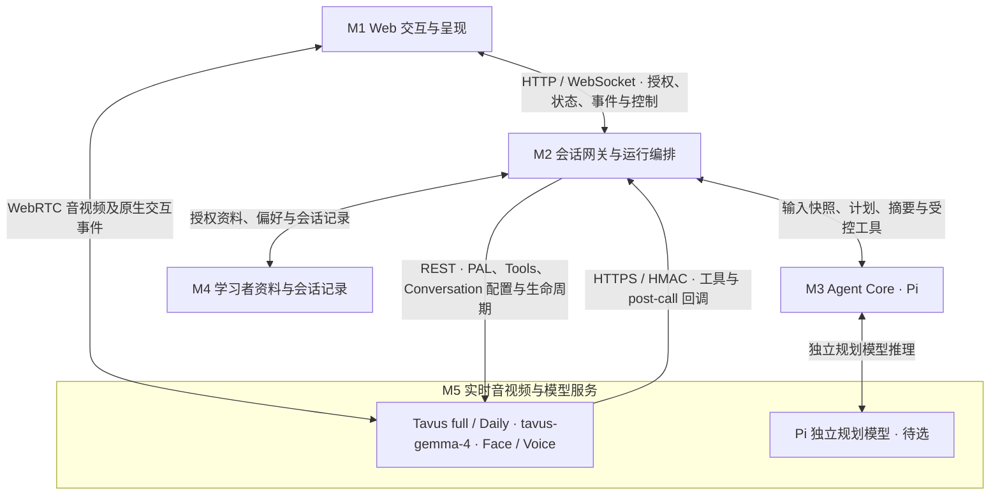

# Tavus Agent POC 实施方案

2026-10-19 · v1.1 · 依据 [PRD v0.5](tavus-agent-poc-prd.md)、[API 接入设计](tavus-layer-and-api-design.md) 与 [Free Talk 目标对照](ask-kai-freetalk-alignment.md)。执行清单见 [task list](task-list.md)。本文定义原生方案的实施设计。主干已合入此前自定义 LLM 方案的离线探针和可复用核心，原生链路仍待按 TA 清单迁移与验收；尚未进行真实供应商调用或部署。详见 [主干合并说明](mainline-merge-notes.md)。

## 1. 实施目标与固定边界

交付可重复演示的独立 Free Talk POC：已有真人老师的 Face 与声音、Tavus 实时交流、Pi 初始及逐轮教学规划、语言与目标控制、同源结束总结、授权会话记录保存读回，并通过源仓库 Free Talk 的必要内容和设备验收。

| 责任 | 实施方式 |
| --- | --- |
| 实时回复与音视频 | Tavus full，`layers.llm.model=tavus-gemma-4`；保留原生 STT、Sparrow、TTS、Phoenix、Daily |
| 教学规划与反馈 | 我们的 Node.js 服务嵌入 Pi；每个有效学生回合都观察/规划，普通回复不等待它 |
| 需要当前结果的交互 | 原生 Tools API 调用教学工具或结束前摘要工具，`on_resolve=generate_response`，由 Tavus 组织口语 |
| 后续建议 | 校验 Pi 提案，经原生上下文事件发送；发送成功不等于供应商已应用或本句已遵循 |
| 身份、状态、工具与证据 | 业务服务程序校验权限、版本、来源、幂等和取消；模型不直接写学习记录 |
| 总结与记录 | 口头、卡片、保存记录共用有版本摘要；post-call 对账修订同一记录 |

P0 不实现自定义 LLM Gateway/SSE、外部 ASR/TTS、Echo、另一套 RTC、MCP 服务器、课程/Topic/Mission 入口或自动发音/掌握评分。回复无固定字数和句数。Tavus 原生记忆、知识库、视觉和 Objectives 不作为当前主链的前置依赖。

所有必要项仍按 PRD 验收；原生能力存在缺口时先修配置与编排。无法满足时登记阻断项，不能自动删要求、换职责边界或用 stock Face 代替真人最终验收。

## 2. M1–M5 顶层模块与内部组件

沿用 Ask Kai Free Talk 的五个顶层模块。M1–M5 表示职责模块，SessionActor、ContextCompiler、ToolDispatcher、SummaryBuilder 等为模块内部组件；代码包和部署进程分别描述，不按目录数量增加顶层模块。



| 顶层模块 | 职责与边界 | 主要代码落点 |
| --- | --- | --- |
| **M1 Web 交互与呈现** | 老师视频/声音、设备、字幕、学习者选择、卡片和播放状态；与 M5 直接收发媒体，与 M2 交换授权业务状态/事件/控制 | `apps/web/` |
| **M2 会话网关与运行编排** | 身份、准备票据、权威会话状态、输入归属、提案接受、取消/收尾、工具鉴权/分发、资源与任务恢复；调用 M4，并协调 M3 | `apps/server/`、`packages/tavus/` |
| **M3 Agent Core** | Pi 初始/逐轮规划、教学规则、语言/难度/目标提案、反馈、上下文编译和同源摘要计算；从 M5 调用独立规划模型，返回结构化结果 | `packages/tutor/`、`packages/evidence/` |
| **M4 学习者资料与会话记录** | 三类授权资料、偏好、会话记录/近期历史与独立学习尝试接口；P0 为 Mock adapter，实际读写由 M2 校验和调用 | `packages/business/`、获准合成 fixtures |
| **M5 实时音视频与模型服务** | Tavus full / Daily、托管 `tavus-gemma-4`、Face/Voice，以及供 Pi 使用的独立规划模型；两种模型用途和接口分开 | 外部服务；适配与配置代码位于 M1/M2/M3 |

M1 与 M2 的 HTTP/WebSocket 承载业务控制，M1 与 M5 的 Daily/WebRTC 承载媒体。M2 生成原生上下文/打断命令后，经授权的 M1 控制连接发送；图中 M2→Tavus 的 REST 连线只表示资源配置与生命周期。工具 HTTPS 请求有对应结果响应；普通状态 callback 的认证/复核规则与工具 HMAC 分开。

M3 经其模型 adapter 调用 M5 的独立规划模型；Tavus 托管 Gemma 生成实时口语，二者不会共用一个虚构推理端点。学生业务资料由 M2 调用 M4 后形成授权快照交给 M3，M3 的业务工具也受 M2 校验。

### 2.1 内部组件归属

| 所属模块 | 内部组件 | 组件职责 |
| --- | --- | --- |
| M1 | MediaAdapter / CaptionReducer / PlaybackAdapter / SummaryView | 媒体设备与输出、渐进字幕、客户端播放报告、同源卡片展示；不裁决业务保存或学习事实 |
| M2 | SessionActor | 每会话串行提交权威状态；绑定 epoch、输入/状态/授权版本，接受或拒绝 M3 提案；模型计算在状态提交之外执行 |
| M2 | PolicyKernel | 强制鉴权、归属、版本、许可、时效与副作用边界；教学语义策略由 M3 提议，不能由模型放宽权限 |
| M2 | TavusClient / EventAdapter | REST 资源生命周期、原生事件规范化与重复/乱序/输入更正处理；共享 PAL/Tools 和每次 Conversation 区分 |
| M2 | ToolDispatcher | 原始字节 HMAC、会话映射、参数/权限校验、调用幂等与结果路由；业务工具经 M2 使用 M4 接口 |
| M2 | ClosingCoordinator | 摘要、回复、播放报告与 closing_id 关联，继续撤销、立即退出和有界超时；工具返回不直接挂断 |
| M2 | JobStore / CleanupWorker | post-call 最小可靠入站、资源清理账本、重启对账与有界恢复；撤权后不提交业务写入 |
| M3 | PiPlanner / PlanningCoordinator | 初始/逐轮提案、有界模型循环、同源任务复用；M2 负责最终接受与权威状态提交 |
| M3 | TeachingPolicy / GoalPolicy / LanguagePolicy / DifficultyPolicy | 教学目标与先修、拒绝/冷却、语言作用范围、帮助程度与中文难度；不维护另一份权威会话状态 |
| M3 | ContextCompiler | 将稳定规则、授权快照和已接受状态/计划编译成最小上下文；由 M2 经 M1 发送到 Tavus |
| M3 | Feedback / Recap / SummaryBuilder | 观察候选、早期内容与来源、覆盖不足、同源摘要计算及 Pi 审查；由 M2 接纳并通过 M4 保存 |
| M4 | LearnerContextPort / PreferencePort / ConversationRecordPort / Mock adapters | 业务读写契约、授权数据存取、revision/hash 幂等与详情/历史读回；业务 Mock 可为内存实现 |
| M5 | Tavus 托管能力与规划模型 provider | 外部模型/媒体服务；Pi 是 M3 的框架，不是 M5 的模型名称 |

M2 的状态是权威业务状态，M3 基于输入快照计算提案与摘要，M4 保存获准资料/记录；这些职责需要同一份来源与版本链。`packages/evidence/` 实现的是 M3 的反馈/摘要计算，实际状态提交在 M2，记录存储在 M4。

### 2.2 工程目录与部署

先用 npm workspace、TypeScript/Node.js。Node 与 Pi 兼容基线沿用 PRD，首次安装时核对并锁版本。M1 在浏览器运行；P0 的 M2/M3/M4 Mock 可同处一个 Node.js 进程，仍通过授权接口和状态边界协作；M5 为外部服务。模块划分不要求五个独立服务。

Web 使用轻量页面加 Daily JS，优先复用现有交互；实际锁文件和工具配置由 TA-02 落实。

```text
apps/web/                  M1：媒体、设备、字幕、资料、小结、播放状态
apps/server/               M2：授权、会话状态、工具、收尾、任务及资源恢复
packages/tavus/            M2：供应商 REST/事件/控制适配；M1 使用其浏览器安全契约
packages/tutor/            M3：Pi 规划、教学策略、ContextCompiler、模型 adapter
packages/evidence/         M3：反馈/recap/SummaryBuilder 计算；提交 M2，保存 M4
packages/business/         M4：资料/偏好/会话记录 Ports 与 Mock adapters
packages/contracts/        跨模块共用 schema、事件、错误与版本契约
config/                    按模块分组的非敏感 PAL/工具/策略模板与版本
scripts/                   配置核对、S1 验证、资源对账；真实操作显式开启
fixtures/                  由对应模块使用的获准合成输入
tests/                     跨模块及组件的契约、状态竞态和浏览器验证
eval/                      独立评测支撑，不进入运行 Agent 的输入
.local/                    忽略提交的最小运行数据和获准报告
```

这些是拟创建路径。模型/HTTP 工作不阻塞其他会话的状态提交；媒体经 Daily/WebRTC 直达 M1。跨模块契约、配置和评测是共用支撑，内部目录不另编号为业务顶层模块。

业务 Mock 资料与会话记录可保持内存，明确“重启重置”。post-call 返回 202 前的可靠接收和孤立 Conversation 清理不能只靠内存：P0 采用同机受控目录下的最小持久任务日志，原子提交、恢复及保留期由 TA-31/32 实现；仅保留获准的结构化候选、资源/版本引用及任务状态，不保存完整逐字稿、音视频或密钥。它不代表业务历史已经持久化。重启后 Mock 授权已失效则任务应拒绝业务写入，资源清理凭服务端资源账本继续对账；不能复活旧授权。

## 3. 复用源仓库的方法

源基线与文件 hash 见 [对照附件](ask-kai-freetalk-alignment.md) 和 [静态检查记录](reference/tavus-contract-audit.json)。TA-01 检查实际版本；若源仓库变化，记录新差异，不静默覆盖当前目标、数据或历史评分。

| 可复用部分 | 拟参考文件 | 适配要求 |
| --- | --- | --- |
| Pi、初始化与提案校验 | `pi-planner.js`、`conversation-initializer.js`、`plan-validator.js` | 提取 provider/业务耦合；不把旧指令字段当 Tavus API |
| 教学状态与语言/目标规则 | `planning-state.js`、`language-support.js`、`goal-lifecycle.js`、`skill-catalog.js` | 保留来源、作用范围、冷却与先修；事件入口换 Tavus |
| 回顾、收尾与记录 | `session-recap.js`、ClosingCoordinator 与 ConversationRecordPort 相关实现 | 摘要契约可复用，PCM 队列/豆包 ACK 不能移植成 WebRTC 播放证明 |
| Mock 资料与 HSK 目录 | 四位学习者、三类资料、同版目录与 skill catalog | 保留作者数据/版本，模型只读最小相关摘要；不复制生产凭证或服务依赖 |
| 案例与评分 | 原 FreeChat 集、语言对照、独立约束和十维评分 | 冻结输入/hash，增加 Tavus 采集适配；参考、oracle 和未来话轮不入运行上下文 |

先登记来源、再抽取最小模块、再用原行为约束和新的 Tavus 边界验证。不会整仓复制后只替换供应商名字，也不修改源仓库。

## 4. 三条执行流程

### 4.1 开聊与逐轮规划

授权读取三类一致资料 → Pi 初始计划 → 校验并补空目标 → 选择有效开场 → 生成一次性准备票据 → 复核身份/资料/偏好/有效期 → 创建私有 Conversation → 麦克风关闭加入 → PAL/媒体就绪后启用采音。

每个有效学生 final 经 EventAdapter/SessionActor 校验后，更新暂态反馈和控制状态，触发一次有界 Pi 规划；普通 Tavus 回复可以并行发生。提案返回时重新校验当前输入 revision、state_version、授权和 epoch；过期不提交。安全回复边界发送最新完整上下文，状态最多称 sent，内容遵循另行评测。

初始 15 秒总时限、逐轮 2 秒总时限沿用 PRD；包含排队、修复、校验和提交。未配置/超时/无效/不可用有独立原因，规则计划不计模型成功。partial、重复、旧回合更正不重复制造尝试。

### 4.2 同步原生工具

Tavus 调用 HTTPS → raw body 验签 → 注册工具白名单 → conversation_id 对应业务身份 → 参数/权限/时效校验 → PlanningCoordinator 或受控业务端口 → 同源同版本结果复用 → 返回结构化结果 → Tavus 生成自然回复。

in_call 两个工具为 `get_next_teaching_action_v1`、`prepare_session_close_v1`；post_call 工具为 `review_session_evidence_v1`。接口形状以技术附件为准。工具调用 ID 幂等与业务事件幂等分开；`generate_response` 不等于模型每次必调用或完全照办。

### 4.3 收尾、保存与课后对账

有效正常结束 → 取消旧规划，建立 closing_id → Pi 审查会话 recap → 固定 summary_revision/hash → 交给 Tavus 回顾，页面显示同一摘要 → 关联实际回复及客户端媒体/字幕结束 → 自动正常退出 → 授权 upsert 并读回同版本记录。

学生继续使旧收尾/预览失效；立即退出跳过口头总结但按许可保存已有最小记录。超时/断线保持 partial/unknown；不能把“停止发声”或等待若干秒当成客户端播完。post-call 后续核对只修订同一记录，保留实际口头摘要版本。

## 5. 实施阶段 S0–S5 与进入条件

S 编号表示实施阶段，M 编号专用于上述顶层模块。原 tasking 的阶段 M0–M4 改为 S1–S5，任务 TA-01–42 的编号、依赖、范围与验收保持一致。

| 阶段 | 任务 | 交付与进入下一阶段的条件 |
| --- | --- | --- |
| S0 基础准备 | TA-01–06 | 可运行最小工程、schema、Mock、Pi adapter 和冻结评测协议；不宣称真实连通 |
| S1 原生能力验证 | TA-07–15 | 最小端到端验证话语归属、上下文、三个工具、收尾播放边界和记录；TA-15 明确能力结论与未通过项 |
| S2 对话与教学 | TA-16–25 | 实际四背景 Free Talk：初始/逐轮、语言/目标/难度、打断、字幕与页面；模型/规则来源可观察 |
| S3 结束与记录 | TA-26–32 | 同源摘要、可撤销收尾、播放确认、自动保存读回、post-call 与重启清理 |
| S4 品牌与系统接入 | TA-33–36 | 正式真人 Face/Voice、中文配置、提示词版本、现有系统内嵌与授权接口演示 |
| S5 正式验收 | TA-37–42 | 关键故障/权限、内容、holdout、长会话、设备、品牌、成本及全部目标完成裁决 |

TA-07–14 是最小可行性实现，后续任务将其产品化；同一组件继续完善，不新建第二条“演示链路”。TA-06 的评测隔离与规范冻结先完成，不能等调好模型再定义通过标准。形成候选后冻结其实际版本/hash，再采集正式结果。

### S1 的六个 Gate

Gate 的定义沿用目标对照附件；S1 是可行性验证，不代替 S5 的完整验收。

| Gate | 主责任务 | 必须留下的证据 |
| --- | --- | --- |
| G01 有效话语与计划 | TA-09、TA-11 | 连续语音的有效 final、重复/更正/乱序、双会话路由、每轮 Pi 触发/降级记录 |
| G02 后续建议生效 | TA-11 | 原生上下文发送与后续真实回复对照；没有 ACK 时保留 unknown，不倒推当前回复 |
| G03 同步工具与竞争 | TA-10、TA-11 | HMAC、Tavus 结果采纳、同源任务复用、超时/重试/迟到隔离 |
| G04 正常收尾 | TA-12 | 摘要先于回顾、closing/回复关联、媒体播放完成方法、继续/立即退出/超时对照 |
| G05 记录闭环 | TA-13 | 正常/异常记录、同版本读回、post-call 修订、幂等/撤权和队列恢复样例 |
| G06 实际中文与 UI | TA-08、TA-14 | 四背景初步中文/中英、慢速/正常、停顿/打断/字幕、真人训练路径；正式品牌待 TA-33/41 |

每项结论只能是 pass、fail、unknown、blocked，并注明覆盖范围。G06 早期用 stock Face 测传输时须标明，不能算真人一致性通过。TA-15 只对证据作判断，不用“所有任务都能启动”代表所有 Gate 通过。

若某 Gate 未通过，停止依赖该能力的正式完成声明，优先复现和修复原生配置/编排；基础状态、Mock 和评测等不依赖该能力的工作仍可继续。无法满足必要要求时提交具体缺口及方案影响，原 P0 不降级为可选。

## 6. 验证与任务完成规则

拟新增 `verify`（静态与确定性契约/状态检查）、`replay`（合成事件回放）、`test:browser`（浏览器合成设备）、`probe:tavus`（显式真实验证）、`eval:collect` / `eval:score`（采集与独立评审）命令。它们目前均不存在，TA-02/06/07 落地后才能报告已运行。默认检查不发真实网络请求，不用假成功替代未配置的服务。

测试集中在会改变结果的边界：跨会话、输入更正、版本竞争、作用范围、撤权、重复副作用、收尾撤销、媒体结束和恢复。页面文案或低影响样式不额外堆叠实现镜像测试。真实供应商与设备每次记录条件、全部分母和失败，不靠重试挑成功样本。

正式内容至少包括原 40 案/244 轮与 8 组语言对照/11 轮、四背景三类需要的 12 场与 12 场独立 holdout，以及三场各 20–30 有效学生回合的长会话和 15 分钟/实际裁剪边界。另执行 E01–E09 耳机/扬声器与品牌 20 段样例。完整方法及十维权重以 PRD 第 14 节为准；历史长度限制不重新约束当前自然回复。

工程实现、合成通过、真实模型/供应商通过、真人设备通过分开记录。任务代码可以 implemented，但依赖真实结果的验收仍为 pending；task list 复选框只有交付物与必需证据齐备时才勾选。未执行、unknown、missing 不等于 pass。

## 7. 外部输入与决策

| 编号 | 待提供/确认 | 影响与可继续的工作 |
| --- | --- | --- |
| D01 | Pi 独立规划模型/provider、可调用接口与本地密钥 | TA-05/11/17/18 的真实模型部分受影响；adapter、schema、合成数据和状态实现可以先做。不能把 Gemma 托管型号填进 Pi 冒充接通 |
| D02 | Tavus 账号/key、真实 HTTPS 验证地址、测试地区与实际套餐 | S1 真实部分受影响；可以先做无网络工程。不指定云厂商，不自动部署或购买 |
| D03 | 获准真人训练素材及参考形象/声音，品牌确认 | TA-14/33 的真实素材与正式验收依赖；stock 只排错，素材制作可与其他工作并行 |
| D04 | 现有系统实际启动/授权/返回页面协议 | TA-36 的最终真实系统联调依赖；本 POC 先给可审查的接口与 Mock 嵌入演示，标明尚未接生产业务 |

这些是输入/执行条件，不是重新开放 Tavus/Pi 已确定的职责选型。Pi 模型和外部输入不会阻止本次 tasking 文档完成，也不意味着开始实施时可以绕过真实验证。

## 8. 调度与提交粒度

首批顺序为 TA-01 → TA-02/03 → TA-04/05/06 → TA-07/08/09/10 → TA-11/12/13/14 → TA-15。每个箭头表示依赖约束；具体 task list 的依赖字段优先。身份/状态框架、评测准备、素材准备可在各自依赖完成后独立推进，不要求额外多进程或多 Agent。

S1 前只排可验证的小批次；完成 TA-15 后，依据实际能力、未通过项、模型延迟、素材状态和工程人员重新估算 S2–S5。暂不沿用旧 10–16 天估计或承诺日期。

每个提交围绕一个可复核变化：契约、模块或必要验证；更新任务状态、实现路径和证据引用。修复失败先保留复现再修正，真实报告不覆盖历史失败。真实原文/录音/密钥不提交仓库；只提交获准合成材料、脱敏结果和版本清单。
