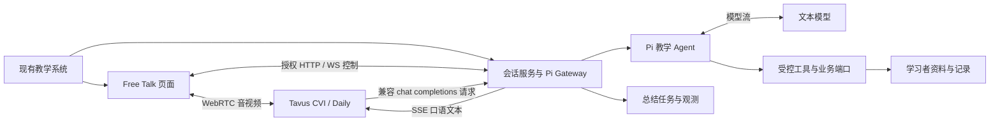
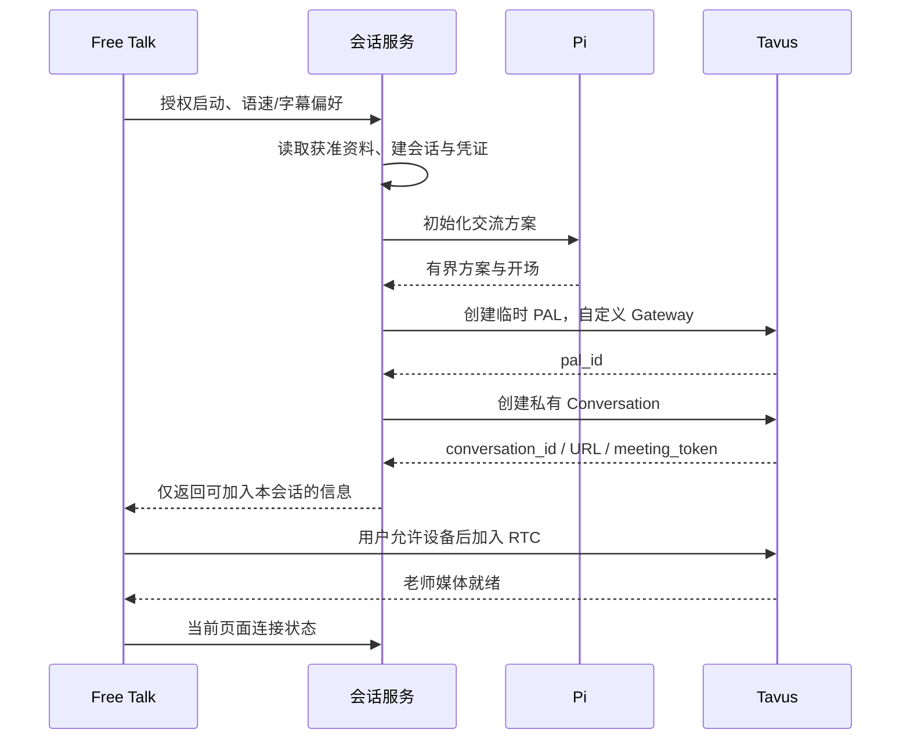

# Tavus Agent POC PRD：基于 Pi 的 Ask Kai 真人数字人中文教师

| 文档项 | 内容 |
| --- | --- |
| 版本 | v0.2，补充分层替换边界与实际 API 接入合同 |
| 日期 | 2026-10-18，Asia/Shanghai |
| 产品参照 | 本机 `ask_kai_freetalk` 的自由对话体验 |
| 用户确认 | 已有真人老师形象，有本人授权，可以拍摄视频 |
| 技术约束 | 第一阶段起使用 pi.dev 作为 Agent 底座 |
| 当前交付 | 研究、PRD 与接入设计；尚未实施及真人联调 |

本文与 [分层控制权及 API 接入设计](tavus-layer-and-api-design.md) 合并构成设计稿。技术附件包含实际 REST 方法/路径、鉴权、Face/PAL/Conversation 请求、Pi SSE、Daily 接入、字幕/打断事件、回调、Echo 替代方案及 OpenAPI 校核记录。

## 1. 产品定义与关键决策

在已有对外汉语教学系统里提供一位可实时面对面交流的 Kai 老师。学生与现有真人老师的数字形象对话；Pi 根据学生意图、授权资料和实际表现选择回应、澄清、示范、纠错或结束；Tavus 呈现声音、表情和口型。学生看到的仍是熟悉的 Free Talk，而不是厂商演示页。

**推荐架构：现有系统页面 → Tavus CVI 实时通话；Tavus 自定义 LLM → 我们的 Pi Gateway → Pi 教学 Agent → 文本模型。** 业务系统保有学生身份、偏好、学习证据与保存回执。

Pi 指 [pi.dev](https://pi.dev/)，使用 TypeScript/Node.js 包，不是 Python。Pi 负责 Agent 执行和工具机制，教学策略由 Ask Kai 实现。Tavus 的兼容 LLM 接口使该架构成立，但连接、取消和效果需要 POC 证明。[Tavus 自定义 LLM](https://docs.tavus.io/sections/conversational-video-interface/pal/llm)

关键决策：

1. 从第一天让 Pi 进入本轮回复路径，不能只做后台建议。
2. 第一交付聚焦 Free Talk；保留未来 Topic/Mission 的数据端口，不同时扩展教学模式。
3. 已有真人老师的定制 Face 是最终验收条件，stock Face 只用于先行技术排错。
4. 先采用 Tavus full pipeline + 自定义 LLM，保留其实时交互能力；中文或控制不合格时再评估拆分语音链。
5. 教学工具、状态和记忆由我们统一管理；Tavus 不成为第二份学习记录事实来源。

## 2. 成功是什么

POC 要回答四个问题：

| 问题 | 必须交付的证据 |
| --- | --- |
| 现有老师能否成为稳定、自然的数字人？ | 正式调优 Face 的品牌审核与真实中文通话样例 |
| Pi 是否真正控制教学？ | 每轮的输入版本、决策、Pi 请求与实际呈现关联；取消与工具回执 |
| 体验能否达到现有 Free Talk 的目标？ | 相同场景下的口语质量、轮次、延迟、字幕和总结对照 |
| 能否嵌入业务系统？ | 已授权会话启动、受控资料接入、结束回调与保存状态演示 |

“最好效果”按综合体验评估：中文正确与自然、学生愿意开口、人物像本人、等待与打断顺畅、教学有帮助。模型参数或演示观感不能替代这些证据。

## 3. 现状、复用与新增范围

现有 Free Talk 是独立本地 POC，使用 Mock 资料，语音走豆包全双工，Pi 有可选规划路径。它不等于已连接真实外部 HSKai，也没有证明本轮语音必然先经过 Pi。依据：[现有 README](/Users/yuqinghuang/Documents/repos/ask_kai_freetalk/README.md)、[Pi 接入设计](/Users/yuqinghuang/Documents/repos/ask_kai_freetalk/docs/pi-integration-tasking.md)。

| 复用 | 需要适配或重建 |
| --- | --- |
| Kai 人格、中文优先、按需英文支架 | Tavus/Daily WebRTC 的采播和状态 |
| 当前意图优先、拒绝练习、零目标聊天 | Tavus 自定义 LLM 的 SSE Gateway |
| 三类学习者资料和授权端口 | Pi 本轮教学决策与口语生成配置 |
| 版本、取消、迟到隔离、幂等原则 | Tavus 与 Pi 双向取消及话轮归属 |
| 有来源的小结和尝试证据 | 实际通话字幕、口型及呈现事件适配 |
| 已有体验场景和评测标准 | 真人 Face/Voice 制作、中文听感评测 |

新仓库独立实现验证路径；复用源项目模块前核对耦合、接口与测试。不能靠复制整个仓库把旧 PCM 协议、豆包特定事件或旧默认配置带入新链路。

## 4. 使用者与 POC 边界

首轮由内部成人测试者与教研人员扮演不同水平学习者，使用合成资料。覆盖现有 Alex/HSK1、Maya/HSK3、Leo/HSK5、Nina/HSK7 四类背景；这些是测试样本，不代表完整等级能力认证。

原产品包含未成年学生，因此上线设计需承接其授权、适龄内容与数据政策；本轮内部 POC 不将这些生产能力标为已完成。

P0 必须包含：

- 单一 Free Talk 入口，系统内嵌、一对一实时交流。
- 指定真人老师的定制 Face、选定 Voice。
- Pi 控制本轮教学与回复，最小业务工具和状态校验。
- 麦克风、静音、字幕、手动/语音打断、退出、异常反馈。
- 中文优先、按需英文支架、慢速/正常、轻纠错与拒绝练习。
- 结束前简短口头回顾，以及证据支持的课后卡片。
- Mock 资料端口、真实业务接入合同、协议与真人体验分层报告。

P1：可选学生摄像头、基于物体/教材的视觉交流、单独示范朗读、受控长期记忆、更多设备与真实业务适配。P0 不要求情绪识别、完整课程、多学生课堂、自动发音打分或全身动作编排。

## 5. 学生旅程与界面

### 5.1 开聊前

学生从现有系统进入 Free Talk。页面保留 Kai 名称与品牌，展示真人数字人预览、AI 身份说明、语速与字幕选择。只有在用户点击开始并取得设备许可后采音；摄像头默认关闭，看到老师不以学生开摄像头为前提。

服务端读取授权的个人画像、学习画像、近期记录，Pi 形成简短初始交流方案。普通聊天不安排必学词，不将历史兴趣变成固定任务。页面分别显示“准备交流方式”“连接老师”“可以开始”，不把会话 API 返回成功当作音视频已就绪。

### 5.2 交流中

主区域是老师视频；旁边或下方是渐进字幕和可选表达卡。移动端以老师、字幕、常用控制优先。学生自己的小窗仅在开启摄像头后出现。

常用控件：麦克风静音、打断/停止老师、字幕开关、结束。慢速/正常可在开聊前选择；会话内切换必须经过实测支持，不能只改按钮状态。可用文字输入为麦克风困难时的辅助入口，需标记输入来源，避免当成语音练习证据。

内部诊断面板可看决策与连接状态；学生页面只显示有用的状态，如“正在听”“正在想”“老师正在说”“连接中断”。后台计算不能驱动视频假装说话。

### 5.3 结束与反馈

说“今天到这里”时，Kai 简短确认并回顾有证据的内容；点击立即结束则停止媒体，不强制播完小结。结束后显示聊过的话题、实际尝试的表达、可选复习建议；没有练习就显示“本次以交流为主”。

是否保存由业务授权和学生选择决定。未收到实际保存回执时显示未保存或处理中；Mock 保存明确标记为本地模拟。断线结束可以生成不完整小结，不填补未发生的练习。

## 6. 教学 Agent 要求

| ID | 行为要求 | 例子或验收重点 |
| --- | --- | --- |
| T01 | 先回应当前意思，每轮一个主要动作 | 学生讲球赛，先聊球赛，不机械进入词汇教学 |
| T02 | 普通聊天目标允许为空 | “今天只想聊天”后不强迫复述 |
| T03 | 明确练习请求才持续推进目标 | “帮我练讲昨天的事”后保持任务连续 |
| T04 | 中文优先，英文支架按需且可撤除 | 不给每句话固定双语翻译；学生要求只中文后遵守 |
| T05 | 语句难度依据当前理解调整 | 听不懂时缩短句子或示范，不仅调整 HSK 标签 |
| T06 | 每轮至多一个重点纠错，避免连问 | 不同时纠正语法、词汇和发音三件事 |
| T07 | 接受停顿、换题、拒绝、打断与结束 | 拒绝练习后有冷却；旧计划不能拉回旧题 |
| T08 | 不从文字转写推断声调或发音正确 | 可教标准读法；不能说“你第三声发得很准”而没有音频证据 |
| T09 | 教学证据只记录实际发生的行为 | 看见词/模型计划不等于练过或掌握 |
| T10 | 收口与课后小结一致 | 相同证据快照生成两种呈现；记录截止版本 |

教学动作可使用现有词表：RESPOND、FOLLOW_UP、CLARIFY、SCAFFOLD、INVITE_PRACTICE、CORRECT、REVIEW、SWITCH_TOPIC、CLOSE。词表是产品合同，不是 Pi 自带能力。

回复不设固定句数，由学生意图、理解情况和当前交流任务决定长短，以自然、完整、有意义地回应为准。简单交流可以简短；解释、示范或澄清时应提供足够内容，并为学生留出回应空间。每轮至多一个追问、至多一个新教学点，避免连续提问或信息堆积。长度和英语比例应通过语义与听感评测确定，不以固定句数或硬截断文本控制回复。

## 7. 真人 Avatar 与声音要求

### 7.1 制作方案

用户已有真人授权且可拍视频，推荐先做 **Phoenix-4.5 上半身视频 Face**。准备正面、稳定、口部清楚的视频；按当前要求，连续 30 秒讲话 + 30 秒静止，至少 1080p、25 FPS。具体拍摄校验遵循官方规范。[训练视频要求](https://docs.tavus.io/sections/faces/phoenix-45-video-requirements)

若品牌必须精确保留服装细纹、标识或全身，则与 Phoenix-4 视频路径比较。两种路径的取舍是自然运动、镜头范围与细节保真；最终以真实素材效果选定。[训练路径](https://docs.tavus.io/sections/faces/which-training-path)

### 7.2 形象一致性验收

建立一份由用户确认的老师参考素材和检查表：脸部辨识、发型、服装、背景、年龄感、声音、语气、镜头。由用户/品牌负责人和教研共同审核，最终 POC 要求这仍然被认作同一个老师。

至少检查 20 段输出：倾听、开口、普通中文、慢速中文、中英切换、长短句、微笑与中途打断。身份漂移、明显变脸、嘴部破损和持续口型错位属于阻断问题。画面好看不能抵消教师身份不一致。

正式效果报告使用调优完成的 Face；预览水印版本单列。Phoenix-4.5 的 `status` 与 `finetune_status` 必须同时核对。[Face 状态](https://docs.tavus.io/sections/faces/phoenix-45-preview-and-status)

### 7.3 中文声音优先级

先试听本人克隆声音，核对声调、轻声、儿化、多音字、数字和中英切换。若与本人相似但普通话示范不足，应优化素材或比较教学声线，再由用户决定品牌声音与教学清晰度的取舍。

TTS 可使用 Tavus Voice 或支持的外部声音，语速控制依引擎而异；P0 固定候选配置做可重复测量，不能每轮随默认路由变化而无法归因。[声音与语速配置](https://docs.tavus.io/sections/conversational-video-interface/pal/tts)

渲染口型是交流呈现，不作为舌位或发音动作教学的可靠示范。需要口腔动作教学时使用经教研审核的独立教材。

Phoenix-4.5 的当前背景定制有明确限制：`properties.apply_greenscreen` 对它解析为 false。与原老师保持一致的背景要在素材和 Face 审核阶段落实，不能把它列为任意可切换参数。详见技术附件第 5 节。

## 8. 系统架构与职责



| 组件 | 拥有的职责 | 不交给它的职责 |
| --- | --- | --- |
| Free Talk 页面 | 媒体设备、视频、字幕、控制、页面状态 | 模型密钥、业务权限、学习结论 |
| 会话服务 | 身份、会话版本、资源映射、凭证、清理 | 冒充媒体层已实际播放 |
| Pi Gateway | Tavus 协议适配、SSE、预算、取消、上下文规范化 | 直接信任来路不明的 learner_id |
| Pi Agent | 意图与教学决策、短回复、受限工具循环 | 任意外部写入、自动判掌握 |
| Tavus | STT、轮次、TTS、Face 视频、RTC | 业务学习记录的最终裁决 |
| 业务适配 | 授权资料、偏好、尝试记录与回执 | 原始媒体转发 |
| 总结任务 | 受许可的证据整理与小结 | 反向修改已经发生的教学事实 |

初期可将会话服务、Gateway 与 Pi 放在同一 Node.js 进程，模块分开；不必一开始部署多个微服务。媒体直接走 RTC，不绕 Pi 服务转发全部音视频。

现有 Free Talk 页面不必为接 Tavus 全面迁移到 React：可直接使用 Daily JS。若采用 Tavus 的 React 组件库，当前 `@tavus/cvi-ui` 是把组件与 hooks 复制进项目的 CLI，需管理生成代码及依赖版本，并非直接从运行时包导入整套服务。[组件库说明](https://docs.tavus.io/sections/conversational-video-interface/component-library/overview)

### 8.1 每层的真实替换边界

| 层 | full 模式下的开放程度 | 完全替换时的架构变化 |
| --- | --- | --- |
| LLM / Agent | 可接任意兼容 chat completions + SSE 后端；本项目接 Pi Gateway | 不必改变 Tavus 媒体链 |
| STT | 可选择 Tavus 支持的引擎；公开 schema 无自定义 STT URL | 外置 ASR，改用 Echo 或第三方实时集成 |
| TTS | 可选支持的供应商、声音及账号；不是任意 TTS URL | 外置 TTS，通过 audio Echo/集成链路驱动 Face |
| Sparrow / 轮次 | 可调耐心和打断参数；无自定义轮次服务端点 | 外部实现 VAD、等待与打断协调 |
| Raven / 感知 | 可配置或关闭；无任意感知服务替换字段 | 关闭后在我们侧处理视觉上下文 |
| Phoenix / 渲染 | 可选择模型和 Face 素材，仍是 Tavus 渲染 | 若坚持使用 Tavus Avatar，该层继续由 Tavus 提供 |
| RTC | 原生 full 使用 Daily；有独立 LiveKit/Pipecat/Agora 集成 | 更换接入路线及对应 SDK，不是任意改一个配置 URL |
| UI、教学记忆与业务工具 | 可由我们自行实现 | 由业务端口与 Pi 统一管理 |

因此 A 路线让 Tavus 控制媒体识别、轮次、朗读与渲染，我们控制教学；B 路线则可让 Tavus 只负责 Avatar。该差异是架构选择的一部分，不能统称“所有层都可自由替换”。具体字段及一手来源见 [技术附件第 1–2 节](tavus-layer-and-api-design.md)。

## 9. Pi 实现方式与实时预算

### 9.1 包与运行时

以现有项目的 `@earendil-works/pi-agent-core@1.2.0`、`@earendil-works/pi-ai@1.2.0` 作为首轮兼容基线，锁确切版本；Node 起点沿用 `>=22.19.0`。升级应作为独立变更验证。核心支持事件、上下文、工具和取消；本项目仍需实现业务校验。[Pi core](https://raw.githubusercontent.com/earendil-works/pi/v1.2.0/packages/agent/README.md)

不引入完整 coding-agent 默认工具；不读本机 Agent 指令或密钥文件，不开放 shell、文件操作或任意网络。Pi 会话上下文从服务端授权快照构建。

#### 文本模型选型记录（2026-10-19）

用户指定 `tavus-gemma-4`。该型号已记录为所选模型意向，接入方式尚待确认：官方将其列为 Tavus 托管 LLM，本次公开文档及已核对 OpenAPI 未确认供 Pi 独立调用该模型的通用推理端点。[官方模型与接口说明](https://docs.tavus.io/sections/conversational-video-interface/pal/llm)

直接在 PAL 的 `layers.llm.model` 使用该型号，意味着由 Tavus 托管模型生成实时回复；这与当前“Pi 生成本轮回复文本”的边界不同。本次仅记录用户选择，不据此调整 Pi/Tavus 职责或改写现有自定义 LLM 配置。待确认可供 Pi 使用的接口，或由用户明确调整职责后，再落实运行配置；不能把型号填写到 Pi 中就视为已接入。

### 9.2 每轮执行

1. 接受经过会话绑定的 Tavus 请求，识别新增学生输入并协调转写修订；拒绝重复执行。
2. 冻结资料、偏好、拒绝状态和历史证据版本，先完成本地权限/取消检查。
3. 使用 Pi 的有界决策配置提交本轮教学动作；代码校验动作、来源和预算。
4. 使用 Pi 的口语生成配置，根据已接受动作输出可朗读文本，转换为 Tavus SSE。
5. 工具参数、推理过程和结构化教学计划不进入 TTS。
6. 区分“文本生成”“转交 Tavus”“人物发声”“客户端呈现”；下一轮据实际证据调整。

第一轮先采取两个有界步骤以便审查控制权，不能把动作 JSON 边生成边朗读。普通闲聊可在验证后优化为一次有受控结果的调用；优化不能绕过权限与当前输入归属。两个步骤是顺序执行配置，不要求两个独立 Agent 服务或多 Agent 系统。

工具初期以初始化时读取资料和本地只读查询为主，避免每句为读相同画像多走模型工具循环。现有 MiniMax 规划模型可作为内容基线，但已有非流式规划适配不等于合格的实时口语生成流；需另行实现和比较。

### 9.3 初始设计预算

以下是工程目标，非实测值，也不是 Tavus 承诺；M0/M1 后校准。

| 项目 | 初始目标/限制 | 超限行为 |
| --- | --- | --- |
| 初始化 | 尽量在 10 秒内可加入；另记冷启动 | 显示准备/失败，超时释放资源 |
| 逐轮决策 | 目标 p95 ≤ 500ms | 使用受控默认动作，记录降级 |
| Gateway 到首个可朗读文本 | 目标 p95 ≤ 1.2 秒，包含决策 | 降低复杂度；失败明确反馈 |
| 学生真实说完到首个可听语音 | p50 ≤ 1.5 秒，p95 ≤ 2.5 秒 | 拆分等待、STT、Pi、TTS、RTC 找瓶颈 |
| 手动停止到本地静音 | 目标 p95 ≤ 200ms | 本地先停播，远端取消另计 |
| 真实语音打断到停止出声 | 目标 p95 ≤ 500ms | 调参或判不满足 Free Talk 体验 |
| 在线调用上限 | 默认决策 1 次 + 生成 1 次；不自动无限修复 | 小结和非必要工具转异步 |
| 总结 | 结束后 30 秒内完成或呈现 pending/failed | 有界重试，不虚构成功 |

若控制方案的延迟超过目标，应比较合并步骤、模型候选和更短上下文；只有测量后才能决定放宽目标或采用备选链路。

## 10. Tavus 接入合同

### 10.1 会话级身份与配置

P0 推荐每会话创建一个临时 PAL，复用已有 Face 和 Voice。PAL 使用一个仅能访问本会话 Gateway 的短期专用凭证。Gateway 根据服务端凭证映射解析会话，不能靠模型正文里的 session_id 或学生姓名判断身份。

这样可避免假设 Tavus 一定转发 conversation ID，也可隔离不同语速与后端配置。代价是创建延迟和资源清理。确认官方实际认证报文、请求头传递与配额后再落地。并发测试通过后，才考虑稳定 PAL + 可靠会话路由的优化。[PAL 生命周期策略](https://docs.tavus.io/sections/onboarding-guide/pal-strategies)

配置意图示例，字段需按实施时 schema 与真实账号验证；占位符不是有效资源：

```json
{
  "pal_name": "Ask Kai session <opaque-id>",
  "pipeline_mode": "full",
  "default_face_id": "<approved-teacher-face-id>",
  "system_prompt": "按 Ask Kai 教学规则交流；业务决策由指定后端执行。",
  "dynamic_greeting": false,
  "languages": ["zh", "en"],
  "layers": {
    "llm": {
      "model": "ask-kai-pi",
      "base_url": "https://<gateway-domain>/v1",
      "api_key": "<session-scoped-gateway-credential>",
      "headers": { "X-AskKai-Session-Key": "<session-scoped-gateway-credential>" },
      "speculative_inference": false
    },
    "tts": { "voice_id": "<approved-teacher-voice-id>" },
    "stt": { "stt_engine": "tavus-auto" },
    "conversational_flow": {
      "turn_detection_model": "sparrow-2",
      "turn_taking_patience": "high",
      "pal_interruptibility": "high"
    },
    "perception": { "perception_model": "off" }
  }
}
```

该凭证仅用于 Tavus → 我们的 Gateway，不能填入真实文本模型密钥。Gateway 内部选用模型，模型 provider key 留在自己的密钥管理中。上例 `voice_id` 路径只说明身份；确定固定 TTS 引擎/模型后按其互斥规则生成实际配置。

### 10.2 启动时序



Conversation 请求使用 `require_auth=true`，不以公开 URL 承担业务认证；单学生配置 `max_participants=2`，含老师。若未来加入可信服务端观察者，需同步调整参与者上限及权限。返回 token 视为敏感凭证，不写普通日志。[Conversation API](https://docs.tavus.io/api-reference/conversations/create-conversation)

开场由 Pi 初始化生成，经校验后用 `custom_greeting` 传给 Tavus；避免双重开场。Gateway 必须部署到 Tavus 能访问的 HTTPS 地址，本机 localhost 只适合离线协议测试；真实联调需要开发部署或受控隧道。

### 10.3 兼容 SSE 端点

拟实现 `POST /v1/chat/completions`，接受兼容 messages/model/stream。返回标准兼容文本增量、停止原因和结束标记；工具调用与中间结果在 Pi 内部完成。该端点是服务间接口，不作为学生浏览器自由调用的模型代理。

Gateway 应处理：系统提示规范化、历史去重、输入修订、超长输入、SSE 分块/断开、并发请求、流超时、取消与有限重试。Tavus 历史仅作为对话数据，服务端教学政策和身份授权优先；学生内容不能提升为系统权限。

输出检查分为权限/格式校验与语义内容审核。流式转交后已经播放的内容无法撤回，异步审核不能被称为“播放前拦截”。需要更严格审核的内容先缓冲可朗读片段再释放，同时计入首响预算；面向真实未成年人的配置须单独完成原产品的适龄验收。

不把 Tavus 每次传来的全部 messages 再追加进 Pi 历史。服务端保有规范上下文，每次提取新增输入与供应商历史差异；中断回复标记 partial。稳定请求 ID 若不可得，M0 必须确定可行去重/重试策略，不能用同一句文本全局去重导致学生合法重复被吞掉。

### 10.4 事件与字幕

媒体层监听 utterance、streaming、started/stopped speaking、joined/left，使用供应商已实际提供的 seq、inference_id 等关联。内部 response_id 与这些字段建立映射，不能假设它们天然相等。[交互事件](https://docs.tavus.io/sections/conversational-video-interface/interactions-protocols/overview)

当前文档说明 PAL 事件可能同时发送 `role=pal` 和旧别名 `role=replica`；适配器优先采用新角色并去重。`turn_idx` 的文档描述与 respond 事件相关，不能未经实测就把它等同自然语音的每次学生轮次。[Utterance](https://docs.tavus.io/sections/event-schemas/conversation-utterance)

字幕消费 Tavus 话语事件，但不能把事件文本直接认定为已播放证据：streaming 的 `properties.speech` 是累计文本，按 `content_index` 更新而非重复追加；完整 utterance 的 speech 在打断时可能包含未说出口的完整生成稿。streaming 用 `is_interrupted`，完整事件用 `interrupted`。渐进文本也不保证逐词音频时间戳；按发声状态呈现短语，无法确认的播放范围保持 unknown，不进入“学生已听到”事实。[流式事件](https://docs.tavus.io/sections/event-schemas/conversation-utterance-streaming)、[完整话语事件](https://docs.tavus.io/sections/event-schemas/conversation-utterance)

### 10.5 必须接入的 API 和生命周期

Tavus REST 基址为 `https://tavusapi.com`，服务端使用 `x-api-key`。真人素材准备时调用 `POST /v2/faces` 并以 `GET /v2/faces/{face_id}` 确认状态；每次会话执行以下顺序：

```text
POST /v2/pals                         建本会话配置，指定 Pi Gateway
GET  /v2/pals/{pal_id}                复核生效配置
POST /v2/conversations               建私有房间，取得 URL 与 token
Daily JS join                       浏览器加入，音视频走 WebRTC
Tavus → 我们 /v1/chat/completions    逐轮调用 Pi，SSE 返回口语文本
Daily app-message                   收字幕/发声事件，发送打断控制
POST /v2/conversations/{id}/end      正常结束，期望 200
GET  /v2/conversations/{id}          复核结束；按需 verbose 对账
DELETE /v2/pals/{pal_id}             清理临时配置，期望 204
```

视频 Face 自带声音满足要求时不用单独创建 Voice。教学工具在 Pi 内部执行时不用 Tavus 工具注册 API。音视频不是逐帧经 REST 发送，打断也不是一个虚构的 REST `/interrupt` 路由。完整字段、请求响应及可选接口见 [技术附件第 3–13 节](tavus-layer-and-api-design.md)。

## 11. 打断、取消和状态一致性

会话状态与教学状态分开。会话可为 preparing、joining、active、closing、closed、failed；教学动作另存。每个在线工作项至少关联 session_id、connection_epoch、student_turn_id、response_id、state_version、consent_version。

手动停止时：

1. 页面先阻止旧音频继续出声，并停止旧字幕推进；保持学生采音。
2. 向 Tavus 发送 `conversation.interrupt`；同时通知我们的会话服务取消对应 Pi 工作。
3. Gateway 使 response 版本失效，关闭输出入口，调用 Pi/模型取消；拒绝迟到文本和工具提交。
4. 记录实际停止、远端状态和未知部分。确认旧输出已停止后恢复正常播放；若无法辨识媒体恢复边界，不提前解除静音。

Tavus 提供 interrupt 事件，但这不自动证明外部模型计算已停止；SDK 的本地静音与输出清理方式需实施时验证。[Interrupt](https://docs.tavus.io/sections/event-schemas/conversation-interrupt)

自动语音打断由 Tavus 先处理媒体，Pi 取消依靠真实事件、SSE 断连与服务端控制协调。不能只靠客户端转发的事件证明供应商事实；客户端消息须有业务会话认证、验证房间与发送者，证据不足时标为 client_reported/unknown。

新输入到来时递增轮次版本，使旧提案失效。同一会话禁止两个未协调的在线生成并行写状态。断线重连创建新 epoch，恢复获准摘要与偏好，不重播旧语音或重复提交学习记录。

对回调端点核对实际可用的认证机制、重放保护和事件格式；本次阅读未确认统一签名保证。无法验证来源的 callback 仅当作查询提示，由服务端使用 Tavus API 复核资源状态，不直接据其提交学习记录、修改学生身份或宣告实际播放完成。

## 12. 业务集成与数据合同

POC 先使用与 Free Talk 对齐的 Mock 端口，真实系统接入属于明确的后续适配交付。演示接口形状不等于已接通外部系统。

| 端口/接口（拟定义） | 输入与输出 | 约束 |
| --- | --- | --- |
| `prepareSession` | 受信身份、入口、偏好 → 会话准备结果 | 验证学习者归属和许可 |
| `getLearnerContext` | 授权身份 → 个人/学习画像、近期记录 | 每份资料带来源、版本和覆盖状态 |
| `startSession` | 准备票据 → 会话 ID 与加入凭证 | 一次性使用、有效期与偏好绑定 |
| `stopResponse` | 会话与回复引用 → 已请求/已停止/未知 | 幂等，区分本地静音与远端取消 |
| `endSession` | 会话、保存选择 → 关闭状态和总结状态 | 无论客户端离开与否都清理远端房间 |
| `saveLearningAttempt` | 获准证据、幂等键 → 实际回执 | 不能保存模型自评为掌握 |
| `getSessionSummary` | 授权会话 → 完整/部分/待处理/失败 | 无来源项拒绝入卡 |

上述为内部端口命名，不是已存在的 Tavus API 或现有业务公开路由。真实系统凭证由自己的身份服务签发，浏览器不得通过传 learner_id 越权。

Pi 工具仅注册这些能力的受限包装，例如读取获准偏好、提出表达卡、提交总结候选。任何写入都要在程序侧验证许可、来源、版本与幂等性。

学习证据区分：老师提到、学生尝试、学生独立使用的候选、未验证。ASR 可能自动纠正学习者错误，不把转写正确当作语法或发音正确。P0 不向真实系统自动写“已掌握”。

## 13. 默认数据与运行策略

初期关闭 Tavus 长期参与者记忆，不发送稳定个人标识；业务侧按授权保存最小资料和学习尝试。开场与上下文不包含不必要的真实身份信息。

原始音视频与完整逐字稿不进入普通日志；内部质量测试如需录制，单独取得测试者许可并规定保留期。运行时短期上下文、保存的学习证据和观测元数据是不同数据类别，分别管理。供应商可能有独立留存，需核实后记录。

摄像头与 Raven 在 P0 默认关闭。P1 若要看图交流，应启用有限视觉用途；不根据面部/声线推测学生情绪来评分。Tavus 已提供关闭感知和限制相关分析的配置，但本产品的政策由我们显式制定。[Perception](https://docs.tavus.io/sections/conversational-video-interface/pal/perception)

清理逻辑由服务端负责：用户退出、连接失败、无人加入、最长时长到达均结束 Conversation；撤销专用 Gateway 凭证，清理临时 PAL，释放会话状态。Face/Voice 是可复用品牌资产，不随会话删除。超时清理要可重试并可查询结果，不能依赖浏览器 beforeunload 一次回调。

结束 Conversation 与删除数据分别处理；SDK 离开房间不等于结束计费，也不等于完成数据删除。[会话超时](https://docs.tavus.io/sections/conversational-video-interface/conversation/customizations/call-duration-and-timeout)

## 14. 质量评测与验收门槛

### 14.1 对照设计

使用现有 Free Talk 作为体验基线，新增 Tavus+Pi 路径。比较时固定学习者资料、输入场景、设备、网络地区与测试顺序；如果同时更换回复模型，报告中明确无法只把变化归因于 Avatar 或 Pi。

先用同一 Pi 教学配置比较候选模型，再固定模型比较 TTS/Face；避免所有组合一次变化。真人通话用场景脚本复现意图，记录实际转写偏差；离线文本回放只证明内容逻辑，不能当真人交互质量。

建议首轮样本：4 类资料 × 9 个体验场景，至少 36 场独立短会话；E01–E09 沿用现有体验定义，另补中文发音与品牌形象样例。场次数是研究设计建议，不能据此宣称具备统计意义上的整体质量保证。

| 类别 | 通过条件 | 证据 |
| --- | --- | --- |
| Pi 控制权 | 普通实时回复全部可关联 Pi 执行；开场与降级单独标记 | 输入版本、决策、生成与呈现链路 |
| 隔离与取消 | 测试集内零跨会话写入、零迟到旧结果覆盖、零重复副作用 | 两会话并发与故障注入 |
| 教学硬规则 | 测试集内零强迫练习、零无证据掌握/发音判断 | 独立教研复核 |
| 正确与适配 | 关键教学内容无严重错误；难度/支架等达到预先锚定标准 | 沿用原十维评分并报告分项 |
| 语音体验 | 达到第 9 节目标，且 E01–E09 无明显阻断问题 | 真实设备/录制测量与人工听感 |
| 真人一致性 | 用户/品牌审核通过，20 段样例无阻断性身份漂移 | 参考素材、正式 Face 版本 |
| 字幕/口型 | 无重复段、旧字幕复活、持续明显错位 | 真实媒体审核，不能只测 DOM |
| 总结 | 每项有真实来源；不足时空或部分结果 | 源片段引用、保存回执 |
| 稳定性 | 建议 20 次启动成功率 ≥95%；至少 3 场 15 分钟连续会话 | 明确实际分母与网络条件 |
| 清理与费用 | 退出/无人加入/失败均有远端结束证据，成本可对账 | 资源列表、请求回执与账单 |

原十维指 intent、correctness、instructions、level、expression、continuity、progress、personalization、persona、safety。不要为本方案另调评分标准使其看起来更好。模型 Judge 只能辅助，中文语音与形象必须人工审查。

### 14.2 中文专项样例

- 三声与变调：“你好”“很好”；“一”“不”的变调、轻声“妈妈”。
- 多音字与分词：“银行”“长大”“音乐”；数字、日期、量词。
- 初学者长停顿、重复、句中自我修正、不同母语口音与中文夹英文。
- 只中文、临时英文求助、持续英文支架与逐步撤架。
- 老师没说完就被学生换题，恢复后回应新话题。

这里评测老师输出与识别鲁棒性，不对学习者给发音分数。

### 14.3 三类报告必须分开

1. 离线/合成：协议、权限、取消、幂等、资料隔离。
2. 真实供应商：账号连通、兼容请求、流式返回、Face 训练状态、资源清理。
3. 真人真机：实际首响、停顿与打断、中文音质、人物一致性和教学感受。

前一类通过不能替代后一类。未知和未运行保持显式状态。

## 15. 故障与降级

| 故障 | 学生体验 | 服务端行为 |
| --- | --- | --- |
| 初始化/PAL 创建失败 | 明确提示未连接，可重试 | 释放半成品与凭证，不启动采音 |
| Pi 决策超时 | 按当前意图给受控简短回应 | 标记默认动作来源，不称模型决策成功 |
| 生成模型不可用 | 停止等待并显示故障/重试 | 有界取消，避免切到未经批准的教学配置 |
| SSE 已出部分内容后失败 | 结束该次回复，允许学生继续 | 标记 partial，不自动从头重播 |
| Tavus 网络/视频失败 | 显示连接状态；可重新开始 | 新 epoch，关闭旧房间；按许可恢复摘要 |
| 学生摄像头拒绝 | 仍可听说并看到老师 | 不要求开摄像头 |
| 麦克风拒绝 | 解释设备状态，可选文字辅助 | 标记 text 输入，避免语音证据混淆 |
| 字幕事件不完整 | 显示部分字幕或暂停字幕 | 不伪造逐字同步 |
| 保存/总结失败 | 未保存、部分或待处理 | 幂等重试，禁止虚构学习成果 |
| 超时清理失败 | 页面已结束 | 服务端重试结束，告警未释放资源 |

如果需要沿用原豆包语音作为降级入口，应作为用户可辨识的重新连接流程，显示当前交互方式；P0 不承诺跨供应商无缝续聊。

## 16. 成本与部署设计

计算总成本时包含：套餐固定费、超额 CVI 分钟、Face/Voice 训练或占用、Pi 内部模型 token、额外 TTS/BYO 服务、Gateway、日志与评测。BYO LLM 不自动代表 Tavus 费用中已扣除模型部分。

用下式建立预算表，实际费率待账号核实：

`总成本 = 固定套餐 + max(0, 计费分钟 - 套餐分钟) × 超额费率 + 素材/声音费用 + 模型费用 + 运行与评测费用`

同时报告每个完成会话、每分钟、失败启动和评测轮次成本。等待、无人加入、打断后仍运行的模型都可能影响费用。初始上限建议每会话 15 分钟、最多 2 个并发内部测试，整体真实测试先按不超过 600 分钟设计；这是用量规划，不是购买授权或报价。

公开价格页有新旧套餐冲突，本稿不固定金额与额度。[官方价格](https://www.tavus.io/pricing)

部署先选择一个靠近主要测试用户且能稳定访问 Tavus 与模型的地区，Gateway 开放服务间 HTTPS，业务 API 保持自己的身份校验。分别测主要目标市场与中国大陆网络；不假设海外 RTC 在所有地区效果一致。

## 17. 实施阶段与进入条件

以下为单个熟悉该项目的全栈工程师、配合教研和素材准备的粗估，非交付承诺。预计约 12–19 个工程工作日；素材、训练、供应商答复和账号等待可能额外增加日历时间。

| 阶段 | 估计 | 交付 | 退出条件 |
| --- | --- | --- | --- |
| M0 可行性探针 | 2–3 天 | Tavus→Pi SSE、认证绑定、取消/重试、两会话隔离；同时提交真人 Face 素材验证 | 自定义后端确实可驱动语音；身份与取消方案成立；真人素材路径可用 |
| M1 最小闭环 | 3–4 天 | Free Talk 页面、Pi 决策与生成、RTC、字幕、退出和 Mock 资料 | 可完成 10 轮真实对话；取消/清理可观察 |
| M2 教学与品牌质量 | 3–5 天 | 正式真人 Face/Voice、支架、轻纠错、总结、中文评测 | 品牌通过；教学规则与音质达到初定标准 |
| M3 系统嵌入与验收 | 4–7 天 | 授权启动、业务适配演示、真机对照、稳定性/成本报告 | 第 14 节证据齐备，决定继续或更换路径 |

M0 如发现身份绑定或打断无法可靠控制，先修正集成方式；不要在不成立的控制路径上大量制作 UI。中文识别/TTS 持续不合格时评估 Echo/自建语音链；真人 Face 不合格时调整素材/渲染路径，且不以 stock Face 冒充满足最终需求。

建议工程目录：

```text
apps/web/                  Free Talk 页面与媒体 UI
apps/gateway/              业务会话、Tavus 控制、兼容 SSE
packages/tutor/            Pi 执行配置、教学动作与校验
packages/tavus/            API、事件、取消与资源映射
packages/business/         Mock 与真实系统适配端口
packages/evidence/         学习尝试、小结与回执
eval/                      既有场景引用、对照和质量报告
docs/                      PRD、研究与后续决策记录
```

## 18. 已确认、默认设计与待验证

| 状态 | 内容 |
| --- | --- |
| 用户已确认 | 同现有 Ask Kai Free Talk 场景；嵌入已有汉语教学系统；从第一天用 Pi；已有真人形象、授权并可拍视频 |
| 本稿推荐默认 | Tavus full + Pi Gateway；上半身真人视频 Face；学生摄像头和感知初期关闭；每会话临时 PAL；业务记忆统一由自己管理 |
| 工程待验证 | 自定义请求认证/绑定/重试；自然语音事件归属；SSE 与 Pi 取消；本地媒体恢复边界；TTS 语速；实际延迟 |
| 效果待验证 | 本人相似度、普通话示范、学习者口音识别、停顿与打断、教学价值 |
| 接入待核实 | 真实系统身份/业务合同、目标端和地区、数据许可、实际套餐与计费 |

技术探针、已有真人素材与业务适配可以按上述默认设计推进；文档不能替代真实供应商和真人体验验收。选型的可定制边界及一手来源详见 [研究说明](tavus-pi-research.md)。
