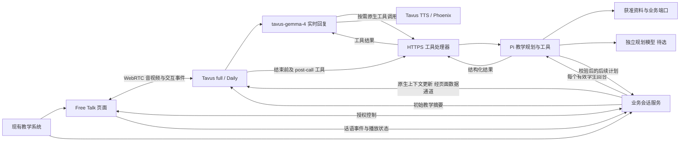
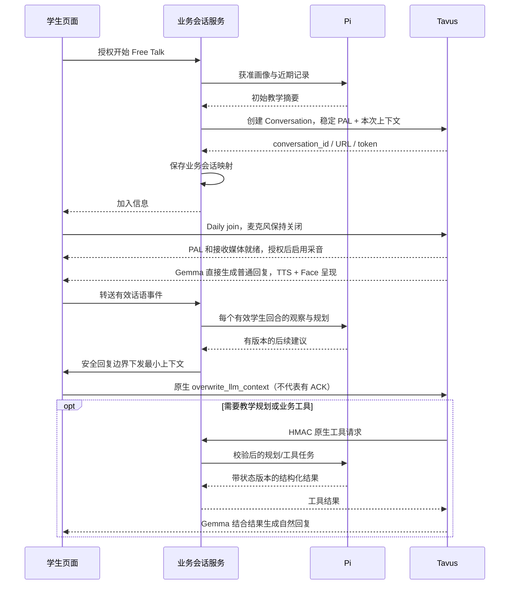

# Tavus Agent POC PRD：基于 Pi 的 Ask Kai 真人数字人中文教师

| 文档项 | 内容 |
| --- | --- |
| 版本 | v0.4，术语修订与 Ask Kai Free Talk 目标对齐 |
| 日期 | 2026-10-19，Asia/Shanghai |
| 产品参照 | 本机 `ask_kai_freetalk` 的自由对话体验 |
| 用户确认 | 已有真人老师形象，有本人授权，可以拍摄视频 |
| 技术约束 | 第一阶段起使用 pi.dev 作为教学规划与工具 Agent 底座 |
| 当前交付 | 研究、PRD 与接入设计；尚未实施及真人联调 |

本文与 [分层控制权及 API 接入设计](tavus-layer-and-api-design.md) 合并构成设计稿。技术附件包含实际 REST 方法/路径、鉴权、Face/PAL/Conversation 请求、原生工具调用 Pi、Daily 接入、字幕/打断事件、回调、Echo 替代方案及 OpenAPI 校核记录。

## 1. 产品定义与关键决策

在已有对外汉语教学系统里提供一位可实时面对面交流的 Kai 老师。学生与现有真人老师的数字形象对话；Tavus 使用 `tavus-gemma-4` 生成实时回复，负责语音与人物呈现；Pi 负责教学规划与受控业务工具。学生看到的仍是熟悉的 Free Talk。

**已确认职责：Tavus full / Daily + `tavus-gemma-4` 生成实时回复；Pi 负责初始规划、逐轮观察与规划、工具及总结审查。** 普通回复不必等待 Pi，但每个有效学生回合都必须进入观察与规划流程（结束/立即退出由专门控制路径处理）；需要本次规划结果或结束总结时，通过 Tavus Tools API 取结果，再由 Tavus 生成口语。

Pi 指 [pi.dev](https://pi.dev/)，使用 TypeScript/Node.js 包，不是 Python。Pi 的规划模型需要独立选型，不能把 `tavus-gemma-4` 直接作为 Pi 可调用模型；本次选择明确落实在 PAL 的 `layers.llm.model`。[Tavus LLM](https://docs.tavus.io/sections/conversational-video-interface/pal/llm)

关键决策：

1. 尽量使用 Tavus 原生能力：保留 STT、Sparrow、托管 LLM、TTS、Phoenix、Daily 和原生工具调用。
2. Pi 从第一天承担初始规划、逐轮规划与工具；普通闲聊可由 Tavus 直接回复，同时异步运行 Pi，不能把逐轮规划缩减为仅在工具被调用时发生。
3. 第一交付聚焦 Free Talk；目标可为空，明确练习请求才持续推进任务。
4. 已有真人老师的定制 Face 是最终验收条件，stock Face 用于先行技术排错。
5. 学生身份、授权、学习证据与保存回执由业务系统管理；Tavus 对话记忆不等于学生已掌握。
6. 本轮不实施自定义 LLM Gateway、兼容 SSE、外部 ASR/TTS 或 Echo；能力边界仍在技术附件保留说明。

Tavus 决定何时调用工具并如何采纳结果。业务服务负责可靠触发逐轮 Pi 规划、校验和提交；Pi 不具备对 Tavus 每句话的播放前审批权。必须分别测量“有效输入是否进入规划”“工具是否触发”“结果是否返回”“建议是否落实”。生成时机的限制不能成为降低教学、语言或结束总结验收要求的理由。

### 1.1 与 Ask Kai Free Talk 相同的完成标准

对照仓库版本 `23f936cfd19081235497a1cb146443045fed075a`（2026-10-19 检查，工作区干净）。范围以其当前 README、implementation-plan 和 Free Talk 专项要求为准；原三入口 PRD 作为产品背景，不把已搁置的 Topic/Mission 工程加回本项目。最新“说话难度”修订虽在源仓库尚未实现，属于本次应覆盖的设计目标，另行标注。

v0.3 尚未完整覆盖源仓库目标：缺少每个有效回合的 Pi 规划、完整目标生命周期、语言请求作用范围、同源口头/页面小结和授权会话记录自动保存读回。v0.4 将这些补为 P0 必须项，详见 [目标逐项对照与缺口处理](ask-kai-freetalk-alignment.md)。保留“自由交流可以零教学、无固定回复句数、未知不冒充能力结论”的要求。

**完成条件是同一套 Free Talk 产品目标在 Tavus 链路上通过验证。** 若 Tavus 原生能力不能满足必要项，POC 该项即未通过；先修复原生配置和编排，不通过删除要求、换 stock Face 或只展示已连接来宣布完成。当前仅完成设计修订，未获得运行或体验通过证据。

### 1.2 术语约定

| 英文/术语 | 本文用法 |
| --- | --- |
| contract | **契约**；规定输入、输出、不变量、错误和版本 |
| native tools / tool calling | Tavus Tools API / 工具调用；“原生”仅说明使用 Tavus 内置机制，业务处理器仍由我们实现 |
| tool delivery | 工具调用传输方式（HTTPS API 或 app-message），不称产品功能交付 |
| scaffolding | 教学或语言支架，即帮助理解、表达的临时支持；按需提供并逐步减少 |
| turn / response | 学生回合 / 老师回复；与网络会话状态分开，不把供应商 turn_idx 直接当成本地学生回合编号 |
| acknowledgement / receipt | 确认/回执；仅表示对应动作的报告，不证明听到、理解或学会 |
| post-call / PAL / Face / SSE | 保留官方英文或标识，首次说明用途，不生造对应中文实体名 |

## 2. 成功是什么

POC 要回答四个问题：

| 问题 | 必须交付的证据 |
| --- | --- |
| 现有老师能否成为稳定、自然的数字人？ | 正式调优 Face 的品牌审核与真实中文通话样例 |
| Pi 是否形成教学反馈循环？ | 初始计划、每个有效回合的观察/规划结果、后续调整、工具、版本校验和来源记录 |
| 体验能否达到现有 Free Talk 的目标？ | 相同场景下的口语质量、轮次、延迟、字幕和总结对照 |
| 能否嵌入业务系统？ | 已授权会话启动、受控资料接入、结束回调与保存状态演示 |

“最好效果”按综合体验评估：中文正确与自然、学生愿意开口、人物像本人、等待与打断顺畅、教学有帮助。模型参数或演示观感不能替代这些证据。

## 3. 现状、复用与新增范围

现有 Free Talk 是独立本地 POC，使用 Mock 资料，语音走豆包全双工，Pi 有可选规划路径。它不等于已连接真实外部 HSKai，也没有证明本轮语音必然先经过 Pi。依据：[现有 README](/Users/yuqinghuang/Documents/repos/ask_kai_freetalk/README.md)、[Pi 接入设计](/Users/yuqinghuang/Documents/repos/ask_kai_freetalk/docs/pi-integration-tasking.md)。

| 复用 | 需要适配或重建 |
| --- | --- |
| Kai 人格、中文优先、按需英文支架 | Tavus/Daily WebRTC 的采播和状态 |
| 当前意图优先、拒绝练习、零目标聊天 | Tavus PAL 提示词与原生工具注册 |
| 三类学习者资料和授权端口 | Pi 规划配置与受控工具处理器 |
| 版本、取消、迟到隔离、幂等原则 | 原生工具回调、结果过期与话轮归属 |
| 有来源的小结和尝试证据 | 实际通话字幕、口型及呈现事件适配 |
| 已有体验场景和评测标准 | 真人 Face/Voice 制作、中文听感评测 |

新仓库独立实现验证路径；复用源项目模块前核对耦合、接口与测试。不能靠复制整个仓库把旧 PCM 协议、豆包特定事件或旧默认配置带入新链路。

## 4. 使用者与 POC 边界

首轮由内部成人测试者与教研人员扮演不同水平学习者，使用合成资料。覆盖现有 Alex/HSK1、Maya/HSK3、Leo/HSK5、Nina/HSK7 四类背景；这些是测试样本，不代表完整等级能力认证。

原产品包含未成年学生，因此上线设计需承接其授权、适龄内容与数据政策；本轮内部 POC 不将这些生产能力标为已完成。

P0 必须包含：

- 单一 Free Talk 入口，系统内嵌、一对一实时交流。
- 指定真人老师的定制 Face、选定 Voice。
- Tavus 实时回复；Pi 初始规划、逐轮观察与规划、按需工具、结束前总结审查和课后核对。
- 麦克风、静音、字幕、手动/语音打断、退出、异常反馈。
- 中文优先、按需英文支架、慢速/正常、轻纠错与拒绝练习。
- 正常口头结束：同一摘要支持口头回顾与页面卡片，播报完成后自动结束；允许学生打断继续或立即退出。
- 四位 Mock 学习者及三类资料界面；授权会话记录自动保存、详情读回与近期记录展示；真实业务接口契约。
- 个性化中文难度、临时/会话/长期偏好作用范围、目标暂停/恢复和有来源的反馈；协议、内容、真人体验分别验收。

P1：可选学生摄像头、基于物体/教材的视觉交流、单独示范朗读、Tavus 原生长期记忆试验、更多设备与真实业务适配。P0 不要求情绪识别、完整课程、多学生课堂、自动发音打分或全身动作编排。

## 5. 学生旅程与界面

### 5.1 开聊前

学生从现有系统进入 Free Talk。页面保留 Kai 名称与品牌，展示真人数字人预览、AI 身份说明、语速与字幕选择。用户点击开始后先以麦克风关闭状态连接，确认 Tavus/PAL 与接收媒体就绪后再申请或启用采音；未就绪不得提前上传麦克风音频。摄像头默认关闭，看到老师不以学生开摄像头为前提。

服务端读取授权的个人画像、学习画像、近期记录，Pi 形成初始交流方案，包含交流目的、内容切入、开场候选、说话难度、支架偏好与约束；自由聊天初始正式目标、候选目标、知识点必须为空，以精简摘要放入本次 Conversation 的 `conversational_context`。普通聊天不安排必学词，不将历史兴趣变成固定任务。页面分别显示“准备交流方式”“连接老师”“可以开始”，不把会话 API 返回成功当作音视频已就绪。

### 5.2 交流中

主区域是老师视频；旁边或下方是渐进字幕和可选表达卡。移动端以老师、字幕、常用控制优先。学生自己的小窗仅在开启摄像头后出现。

常用控件：麦克风静音、打断/停止老师、字幕开关、结束。慢速/正常可在开聊前选择；会话内切换必须经过实测支持，不能只改按钮状态。可用文字输入为麦克风困难时的辅助入口，需标记输入来源，避免当成语音练习证据。

POC 页面提供四位虚构学习者选择与三类资料查看；活动会话锁定学习者。切换、更正偏好或准备过期都会撤销旧准备、清除旧字幕/小结，并重新校验授权与资料版本。

内部诊断面板可看初始及逐轮规划、规则降级、上下文发送、工具和连接状态；学生页面只显示有用的状态，如“正在听”“正在想”“老师正在说”“连接中断”。后台计算不能驱动视频假装说话。

### 5.3 结束、同源小结与保存

学生明确说“就聊到这里吧”后，进入 `preparing_close → presenting_close → awaiting_playback → finalizing_record → closed`。停止普通逐轮规划和旧目标推进，通过原生 `prepare_session_close_v1` 工具让 Pi 审查本次已有记录，生成带 `closing_id/summary_revision/hash` 的结构化摘要；由 Tavus 生成自然的回顾与告别，页面从同一摘要显示卡片，不再各自独立生成两个小结。口头可以选重点，卡片展示完整有界条目；两者必须对应同一目标、知识项与会话来源，回顾后不再追问或布置新练习。

摘要包含三部分：`objective`（交流目的、初始目标与真实变更/状态）、`knowledge_points`（实际涉及的词汇、表达、用法、可选拼音/释义及来源）、`conversation_recap`（实际聊到的内容）。零正式目标写“自然交流”；零可核验知识项仍可回顾交流。不把提到、教师示范、学生尝试、未评估或掌握混为一谈，不要求复盘出完整知识清单。

收尾期间继续采音；学生说“等等，我还想问”时使旧 closing_id 和预览失效，停止旧总结并恢复交流，不自动恢复被拒绝的练习。点击立即结束、离开或明确说“不用总结，马上结束”则立即清理媒体，不等口头回顾。引语、翻译问题、否定和旧回合告别不能触发挂断。

自动正常结束必须核对收尾回复、摘要版本、供应商发声状态和实际客户端媒体播放结束。`stopped_speaking`、utterance.final 或工具返回不单独证明播放完成；Daily/WebRTC 是否能提供足够的媒体边界需 M0 验证。缺少可核验边界时按有界超时结束，显示“语音小结未完成/未确认”，保留文字卡，**该次正常口头收尾验收不通过**，不能以固定延时冒充播完。

在具有会话记录写权限时，结束自动保存本次会话摘要、真实结束状态和版本，并提供授权详情读回及历史展示；不依赖旧“保存表达尝试”勾选框。保存状态分为 pending/accepted/failed/unknown，只有服务端确认并能读回同 revision/hash 才显示已保存。Mock 内存保存标明重启重置。正式学习尝试写入是独立操作，仍需其授权与证据，不能用会话摘要更新永久掌握。

post-call 工具仅负责结束后的来源核对、补充与异常恢复，不能代替结束前的小结。若校正摘要，产生新 revision 并说明差异；旧口头播报引用仍保留原版本，不伪称已说过新内容。所有写入按同一会话记录幂等更新，拒绝旧版本覆盖；撤权后停止写入。

## 6. 教学 Agent 要求

| ID | 行为要求 | 例子或验收重点 |
| --- | --- | --- |
| T01 | 先回应当前意思，每轮一个主要动作 | 学生讲球赛，先聊球赛，不机械进入词汇教学 |
| T02 | 普通聊天目标允许为空 | “今天只想聊天”后不强迫复述 |
| T03 | 明确练习请求才持续推进目标 | “帮我练讲昨天的事”后保持任务连续 |
| T04 | 中文优先，英文支架按需且可撤除 | 不给每句话固定双语翻译；学生要求只中文后遵守 |
| T05 | 语句难度依据当前理解调整 | 听不懂时缩短句子或示范，不仅调整 HSK 标签 |
| T06 | 每轮至多一个重点纠错，避免连问 | 不同时纠正语法、词汇和发音三件事 |
| T07 | 接受停顿、换题、拒绝、打断与结束 | 拒绝练习后有冷却；旧计划不能拉回旧题 |
| T08 | 不从文字转写推断声调或发音正确 | 可教标准读法；不能说“你第三声发得很准”而没有音频证据 |
| T09 | 教学证据只记录实际发生的行为 | 看见词/模型计划不等于练过或掌握 |
| T10 | 同一摘要支撑口头、页面和会话记录 | closing_id、summary_revision/hash 对应；取消继续后旧版本失效 |
| T11 | 每个有效学生回合形成观察与下一步计划 | 普通交流可异步，不以“未调用 Tavus 工具”跳过 Pi |
| T12 | 正确表达不制造纠错，歧义仅必要澄清一次 | 已有明确前文不重复问；连续不明时低压等待 |
| T13 | 主动教学后两个有效学生回合不再叠加新点 | 当前明确求助可获帮助；重复/partial 不消耗冷却 |
| T14 | 语言、帮助与难度请求有明确有效范围 | 当前回复/本场会话/授权画像分开；旧完成不清除新请求 |
| T15 | 当前需要、听力与表达能力分别调整 | 英文、短句、沉默本身不证明能力弱；兴趣不代表已掌握 |

教学动作可使用现有词表：RESPOND、FOLLOW_UP、CLARIFY、SCAFFOLD、INVITE_PRACTICE、CORRECT、REVIEW、SWITCH_TOPIC、CLOSE。词表是产品契约，不是 Pi 自带能力。

回复不设固定句数，由学生意图、理解情况和当前交流任务决定长短，以自然、完整、有意义地回应为准。简单交流可以简短；解释、示范或澄清时应提供足够内容，并为学生留出回应空间。每轮至多一个追问、至多一个新教学点，避免连续提问或信息堆积。长度和英语比例应通过语义与听感评测确定，不以固定句数或硬截断文本控制回复。

### 6.1 自由目标与反馈

初始计划模型仅产出交流目的、内容切入、开场候选、策略与依据；不接收技能候选，不要求生成目标字段。业务编译器固定补齐 `primary_goal_id:null / candidate_goal_ids:[] / key_points:[]`，模型越界输出目标时拒绝并在原时限内修复或明确规则降级。

问“这个词怎么说”只建立本轮 `local_help_target`；明确要求持续练习时，Pi 才能从版本化通用 Skill catalog 选目标并核对先修，mode 始终 free，不读取 Topic Pack/课程。目标状态至少有 active、paused、retired、unverified；拒绝/换题立即暂停，停止后 retired，关键词重现不得恢复，只有当前明确请求才恢复或改选。先修未知不等于不会；先降低本轮负担，不能凭英文、停顿或一次困难自动退级。

每轮反馈记录实际学生输入、前次实际回复/提示的可观测范围、理解/困难/拒绝及来源。计划、已生成稿和播放报告不等于已理解或独立使用。未校准的通用技能保持 unassessed；即使请求合理也不能自动生成正式 attempted 或 mastered。输入更正替换同一观察，不重复累计；引语、转述、否定、自述“我会了”不能冒充练习事实。

### 6.2 语言请求与个性化难度

中文优先；必要英文紧随所解释的中文，解释同一意思，不加第二个问题。明确只中文时，确认本身也只中文。学生用英文回答不等于要求老师全英文。

| 请求来源 | 生效范围 | 结束与恢复 |
| --- | --- | --- |
| “这句只中文/加英文解释”或本次理解/表达求助 | 当前帮助回复 | 完成、取消或被新输入取代后失效，恢复有效会话偏好 |
| “接下来只中文/以后说简单些/恢复自动” | 当前会话 | 直到新的明确设置，不自动保存画像 |
| 页面授权保存偏好 | 后续会话画像 | 经业务接口实际保存；更正使旧准备失效 |

支架程度、中文难度与语速分别决定。Pi 初始和逐轮策略包括 `support_level` 及 `speaking_difficulty`：`lexical_style=everyday/precise`、`sentence_structure=simple/linked/flexible`、`new_word_policy=avoid/one_explained/requested_only`，以及来源、理由和范围；不按姓名写四套固定答案。开场优先由 Pi 给出交流候选后从审核过的表达范围选择，避免固定开场使个性化计划没有实际落点。

沿用源仓库 2026-10-18 的难度设计目标：普通主动用词以上下文中已达 `course_level` 为上限，不用下一学习阶段推高范围；使用同版本 HSK 目录。Alex/Maya/Leo 对应一/三/五级；Nina 保留七级背景，但目前七至九级共同目录没有独立七级词义划分，普通主动用词使用可核对的一至六级范围，观点深度可保持高级。明确问超范围词时仅为该词提供局部解释，不扩成整轮升阶，不登记掌握。分词、专名、数字和义项由独立内容复核，不能靠字符串匹配或提示词宣称严格达标。

“帮助表达多少”与“Kai 说多难”不能互相替代；慢速不代表低词汇等级，少英文不代表提高难度。普通主动教学最多一个新点，不限制正常交流的词数、句数或内容深度。实际口语违反有效约束时记为内容失败，不以 Pi 字段正确抵销。

## 7. 真人 Avatar 与声音要求

### 7.1 制作方案

用户已有真人授权且可拍视频，推荐先做 **Phoenix-4.5 上半身视频 Face**。准备正面、稳定、口部清楚的视频；按当前要求，连续 30 秒讲话 + 30 秒静止，至少 1080p、25 FPS。具体拍摄校验遵循官方规范。[训练视频要求](https://docs.tavus.io/sections/faces/phoenix-45-video-requirements)

若品牌必须精确保留服装细纹、标识或全身，则与 Phoenix-4 视频路径比较。两种路径的取舍是自然运动、镜头范围与细节保真；最终以真实素材效果选定。[训练路径](https://docs.tavus.io/sections/faces/which-training-path)

### 7.2 形象一致性验收

建立一份由用户确认的老师参考素材和检查表：脸部辨识、发型、服装、背景、年龄感、声音、语气、镜头。由用户/品牌负责人和教研共同审核，最终 POC 要求这仍然被认作同一个老师。

至少检查 20 段输出：倾听、开口、普通中文、慢速中文、中英切换、长短句、微笑与中途打断。身份漂移、明显变脸、嘴部破损和持续口型错位属于阻断问题。画面好看不能抵消教师身份不一致。

正式效果报告使用调优完成的 Face；预览水印版本单列。Phoenix-4.5 的 `status` 与 `finetune_status` 必须同时核对。[Face 状态](https://docs.tavus.io/sections/faces/phoenix-45-preview-and-status)

### 7.3 中文声音优先级

先试听本人克隆声音，核对声调、轻声、儿化、多音字、数字和中英切换。若与本人相似但普通话示范不足，应优化素材或比较教学声线，再由用户决定品牌声音与教学清晰度的取舍。

TTS 可使用 Tavus Voice 或支持的外部声音，语速控制依引擎而异；P0 从 `tavus-auto + 老师 voice_id` 起步，记录实际返回/可观测配置及样例；自动路由会增加归因限制，不能假称已锁定底层供应商。仅当中文质量或语速不达标时，比较 Tavus 支持的显式引擎配置，不先自建 TTS。[声音与语速配置](https://docs.tavus.io/sections/conversational-video-interface/pal/tts)

渲染口型是交流呈现，不作为舌位或发音动作教学的可靠示范。需要口腔动作教学时使用经教研审核的独立教材。

Phoenix-4.5 的当前背景定制有明确限制：`properties.apply_greenscreen` 对它解析为 false。与原老师保持一致的背景要在素材和 Face 审核阶段落实，不能把它列为任意可切换参数。详见技术附件第 5 节。

## 8. 系统架构与职责



| 组件 | 拥有的职责 | 控制边界 |
| --- | --- | --- |
| Free Talk 页面 | 设备、视频、字幕、控制、页面状态 | 不持有服务密钥，不裁决学习结论 |
| 业务会话服务 | 身份、授权、会话版本、资源映射、清理 | 不把房间创建视为媒体就绪 |
| 工具处理器 | HMAC 验签、会话路由、幂等、超时与结果过期校验 | 不信任模型参数中的 learner_id 或自报证据 |
| Pi Agent | 初始/逐轮规划、反馈调整、按需业务工具、结束前摘要与课后审查 | 返回结构化建议和事实，实时口语由 Tavus 生成 |
| Tavus | STT、Sparrow、Gemma 回复、原生工具编排、TTS、Face、RTC | 工具触发与建议落实需评测；业务写入由服务端裁决 |
| 业务适配 | 授权资料、偏好、尝试记录与真实回执 | 不依据厂商记忆自动判定掌握 |

初期会话服务、工具处理器与 Pi 可在同一 Node.js 进程运行，按模块分开。媒体直接走 RTC，不经 Pi 转发。无需自建 `/v1/chat/completions`。

现有页面可直接使用 Daily JS；采用 Tavus React 组件时，`@tavus/cvi-ui` 当前是复制组件/hooks 到项目的 CLI，需管理生成代码版本。[组件库说明](https://docs.tavus.io/sections/conversational-video-interface/component-library/overview)

### 8.1 每层的真实替换边界

| 层 | full 模式下的开放程度 | 完全替换时的架构变化 |
| --- | --- | --- |
| LLM / Agent | 可接兼容 chat completions + SSE 后端；本 POC 保留托管 `tavus-gemma-4` | 不必改变 Tavus 媒体链 |
| STT | 可选择 Tavus 支持的引擎；公开 schema 无自定义 STT URL | 外置 ASR，改用 Echo 或第三方实时集成 |
| TTS | 可选支持的供应商、声音及账号；不是任意 TTS URL | 外置 TTS，通过 audio Echo/集成链路驱动 Face |
| Sparrow / 轮次 | 可调耐心和打断参数；无自定义轮次服务端点 | 外部实现 VAD、等待与打断协调 |
| Raven / 感知 | 可配置或关闭；无任意感知服务替换字段 | 关闭后在我们侧处理视觉上下文 |
| Phoenix / 渲染 | 可选择模型和 Face 素材，仍是 Tavus 渲染 | 若坚持使用 Tavus Avatar，该层继续由 Tavus 提供 |
| RTC | 原生 full 使用 Daily；有独立 LiveKit/Pipecat/Agora 集成 | 更换接入路线及对应 SDK，不是任意改一个配置 URL |
| UI、教学规划与业务工具 | 可由我们实现，经原生 Tools API 接入 | Pi 管计划和授权工具；Tavus 原生记忆可独立启用 |

当前 A 路线保留 Tavus 实时链，Pi 通过原生工具提供规划与业务能力。自定义 LLM 和 Echo 是其他可行模式，不纳入本 POC。该差异是架构选择的一部分，不能统称“所有层都可自由替换”。具体字段及一手来源见 [技术附件第 1–2 节](tavus-layer-and-api-design.md)。

## 9. Pi 实现方式与执行时限

### 9.1 包与运行时

以现有项目的 `@earendil-works/pi-agent-core@1.2.0`、`@earendil-works/pi-ai@1.2.0` 作为首轮兼容基线，锁确切版本；Node 起点沿用 `>=22.19.0`。升级应作为独立变更验证。核心支持事件、上下文、工具和取消；本项目仍需实现业务校验。[Pi core](https://raw.githubusercontent.com/earendil-works/pi/v1.2.0/packages/agent/README.md)

不引入完整 coding-agent 默认工具；不读本机 Agent 指令或密钥文件，不开放 shell、文件操作或任意网络。Pi 会话上下文从服务端授权快照构建。

#### 模型选型记录（2026-10-19）

| 用途 | 选型 | 状态 |
| --- | --- | --- |
| 实时口语回复 | Tavus 托管 `tavus-gemma-4` | 用户已确认，配置 `layers.llm.model` |
| Pi 教学规划、工具推理与课后审查 | 独立可调用的模型/provider | 待选；现有 MiniMax 适配仅作候选基线 |

本次职责调整解决托管模型无法直接按原设计交给 Pi 调用的冲突。无需为 Tavus 原生 LLM 配置自定义 `base_url/api_key`；Pi 的模型密钥仍留在我们的服务端。[官方 LLM 配置](https://docs.tavus.io/sections/conversational-video-interface/pal/llm)

### 9.2 Pi 的执行与计划生效

1. **开聊前**：读取授权的三类资料，Pi 提交初始计划；校验来源、策略、空目标与资料版本，编译为 Conversation 上下文，并选择合适开场。保存已接受的计划版本与编译内容摘要。
2. **每个有效学生回合**：Tavus 的有效 final 话语事件经适配器和业务服务校验、去重、处理输入更正后，触发一次 Pi 观察/规划。输入包含实际当前句、有限实际前文、前一回复的执行情况、有效语言/目标/拒绝/冷却状态。partial 不形成正式决策。普通实时回复继续由 Tavus 生成，不等待这次异步计划。
3. **后续输入前**：同一会话串行接受最新有效提案；无活动发声、待取消或待结束时，将完整最小上下文经原生 `conversation.overwrite_llm_context` 更新。保留全局规则、授权背景、当前状态和最新建议，不能覆盖丢失基础约束。新输入/更正/撤权/新 epoch 使旧提案失效；无法确认适用边界就不发送旧建议。
4. **按需同步工具**：Tavus 在需要本次规划或查询结果时调用 `get_next_teaching_action_v1`。与后台规划共用同一规划协调器；同源同版本复用结果，不启动两个互相覆盖的计划。`on_resolve=generate_response` 让 Tavus 根据结果生成回复；不给 Pi 连续口语生成接口。
5. **正常结束前**：Tavus 调用 `prepare_session_close_v1`，业务服务核对结束意图、暂停普通规划，由 Pi 审查现有有来源摘要，返回同一摘要供口头和卡片；工具本身无挂断权限。
6. **结束后**：原生 post-call 工具提交候选，快速入队；Pi 补充来源核对与必要校正，通过同一 ConversationRecordPort 更新/读回记录，不重复追加两份总结。

逐轮结果至少有 `decision_id/source_turn_id/input_revision/based_on_state_version/evidence_refs/action/reply_directive/expected_observation/effective_scope`；字段是业务契约，不冒充 Tavus API。程序检查权限、来源、策略、时效、先修与拒绝，语义质量另评。无模型、超时、无效或不可用均可走有标记的规则计划；规则不虚构模型成功，不取消每轮有结果或明确失败原因的要求。

原生上下文交互目前未确认有版本化 ACK；记录 proposed、accepted、sent、tool_result_returned、observed_adherence 等不同状态，不捏造 applied/generation_gated。异步计划用于后续输入，不证明已开始的当前回复采用了它。该限制与源仓库的 next_turn_advisory 边界相同；实际后续遵循与结束工具执行仍须通过必要场景，不能因此降低产品目标。[Tavus 交互事件](https://docs.tavus.io/sections/conversational-video-interface/interactions-protocols/overview)

事件流经授权页面转送时标为 client_reported，供暂态教学编排而非最终业务事实；必须验证房间、发送者、输入归属和顺序。缺事件、关联不明或重复更正须明确失败/待核实，不能假称逐轮覆盖完整。课后使用获准的服务端来源复核。

### 9.3 初始执行与体验目标

下列是工程目标，非实测或 Tavus 承诺；M0/M1 后校准，分别记录普通回复与工具回复。

| 项目 | 初始目标/限制 | 超限行为 |
| --- | --- | --- |
| 初始化 | 总时限 15 秒，包含资料读取、Pi、一次有界修复与校验；另记冷启动 | 明确模型/规则来源与失败原因，不提前上传采音 |
| 逐轮规划 | 从有效输入接受起最多 2 秒，含排队、修复、校验和提交，预留 200ms 提交 | 明确规则计划/超时，不把晚到提案算成功 |
| 普通对话：学生说完至可听语音 | p50 ≤ 1.5 秒，p95 ≤ 2.5 秒 | 分离等待、STT、LLM、TTS、RTC 排查 |
| 在线教学工具 | HTTP timeout 初始 3 秒；Pi 内部工作截止 2 秒，给网络留余量 | 取消未完成工作，明确不可用；不声称采用了计划 |
| 工具回复：学生说完至可听语音 | 初始 p95 ≤ 5 秒，报告工具附加等待 | 若等待破坏交流，简化上下文/规划或改为后续建议 |
| 手动停止到本地静音 | p95 ≤ 200ms | 远端停止另计，不能仅看按钮 |
| 真实语音打断到停止出声 | p95 ≤ 500ms | 调参或判不满足体验 |
| Pi 在线执行 | 每有效回合一次有界规划；同步工具复用同源结果；无无限修复 | 普通生成不等待计划，未完成旧工作取消 |
| 课后卡片 | 结束后 30 秒内完成，或明确 pending/failed | 有界重试，不能虚构成功 |

保持原生 speculative inference 默认开启作为首轮基线；测量输入修订、取消和工具误触发后才决定是否关闭。在线规划工具默认只读/返回提案，不因提前推理就提交学习记录。

## 10. Tavus 接入契约

### 10.1 稳定 PAL 与会话级上下文

P0 使用按老师/声音/教学规则版本管理的稳定 PAL。PAL 设置 `pipeline_mode=full`、`layers.llm.model=tavus-gemma-4`、原生 STT/TTS/Sparrow；关联教学工具、结束前摘要工具和 post-call 工具。具体 JSON 见技术附件第 6、11 节。

每次启动只新建 Conversation，传本次 Pi 初始摘要、开场、偏好与授权范围。不同学生不通过 PATCH 共享 PAL 改配置；确有独立语速配置需要时使用经过验证的 PAL 变体。Face、Voice、PAL 和 Tools 是可复用资源，不随每次结束删除。[PAL 策略](https://docs.tavus.io/sections/onboarding-guide/pal-strategies)

业务服务先保存 `business_session_id ↔ conversation_id ↔ pal_id ↔ learner授权快照`。原生 HMAC 工具 envelope 提供 conversation_id/tool_call_id，处理器据此路由；不依赖临时 PAL 凭证或模型自报身份。

### 10.2 启动与在线工具时序



Tavus key、工具 HMAC secret、Pi 模型 key 只在服务端。工具接收端必须是 Tavus 可达的 HTTPS；localhost 不能用于真实服务间交付。

### 10.3 Tavus Tools API 调用 Pi：接口契约

`POST /v2/tools` 注册 `get_next_teaching_action_v1`，设置 `trigger_type=in_call`、`origin=llm`、`on_call=silent`、`on_resolve=generate_response`、HTTPS/HMAC delivery；随后 `POST /v2/pals/{pal_id}/tools` 关联。不能只创建工具却不关联 PAL，也不用旧 `layers.llm.tools` 内联格式。

我们实现 `POST /hooks/tavus/tools`：原始字节验签 → 允许的工具名 → conversation_id 映射 → 解析 arguments → 幂等与版本检查 → Pi/受控端口 → 结构化结果。幂等键包含 conversation_id、tool_call_id；跨重试复用结果，不按学生文本全局去重。

结束前工具 `prepare_session_close_v1` 使用 in_call/llm、silent、generate_response，返回有版本的结构化摘要；不返回指定逐字朗读的最终台词。

课后工具使用 `trigger_type=post_call`，省略 origin，交付到独立 `/hooks/tavus/post-call`；先持久入队再返回成功。对话结束与课后投递/处理是不同状态；重复 HTTP 投递不重复保存。[Post-Call Actions](https://docs.tavus.io/sections/conversational-video-interface/pal/post-call-tool)

原生工具超时、漏调用、迟到结果与打断后的再发声要实测。我们能拒绝旧版本写入，不能仅凭内部 state_version 宣称 Tavus 已撤回旧工具结果或已缓冲语音。

### 10.4 事件与字幕

媒体层监听 utterance、streaming、started/stopped speaking、joined/left，使用供应商已实际提供的 seq、inference_id 等关联。内部 response_id 与这些字段建立映射，不能假设它们天然相等。[交互事件](https://docs.tavus.io/sections/conversational-video-interface/interactions-protocols/overview)

当前文档说明 PAL 事件可能同时发送 `role=pal` 和旧别名 `role=replica`；适配器优先采用新角色并去重。`turn_idx` 的文档描述与 respond 事件相关，不能未经实测就把它等同自然语音的每次学生轮次。[Utterance](https://docs.tavus.io/sections/event-schemas/conversation-utterance)

字幕消费 Tavus 话语事件，但不能把事件文本直接认定为已播放证据：streaming 的 `properties.speech` 是累计文本，按 `content_index` 更新而非重复追加；完整 utterance 的 speech 在打断时可能包含未说出口的完整生成稿。streaming 用 `is_interrupted`，完整事件用 `interrupted`。渐进文本也不保证逐词音频时间戳；按发声状态呈现短语，无法确认的播放范围保持 unknown，不进入“学生已听到”事实。[流式事件](https://docs.tavus.io/sections/event-schemas/conversation-utterance-streaming)、[完整话语事件](https://docs.tavus.io/sections/event-schemas/conversation-utterance)

### 10.5 必须接入的 API 和生命周期

Tavus REST 基址 `https://tavusapi.com`，服务端 `x-api-key`。素材阶段创建/查询 Face；配置阶段创建/查询 PAL、注册/关联工具；会话阶段复用资源：

```text
配置时 POST /v2/faces                         创建真人老师资产，GET 等待正式就绪
配置时 POST /v2/pals                          full + tavus-gemma-4
配置时 POST /v2/tools                         教学工具、结束前摘要工具、课后工具
配置时 POST /v2/pals/{pal_id}/tools           关联后 GET 核对工具与 PAL
运行时 POST /v2/conversations                Pi 初始摘要 + 私有房间
运行时 Daily JS join / app-message           音视频、字幕和打断
每轮   话语事件 → 业务服务 → Pi                观察与下一步计划，校验后更新原生上下文
按需   Tavus → /hooks/tavus/tools             教学结果或结束前摘要，Tavus 组织回复
结束时 POST /v2/conversations/{id}/end        正常结束，200
核对时 GET /v2/conversations/{id}             远端状态，按许可 verbose 对账
课后   Tavus → /hooks/tavus/post-call         候选入队，Pi 审查，业务保存回执
```

视频 Face 默认声音可用时无需另建 Voice。不再实施 SSE 接口或每会话删 PAL。数据删除与日常 end 分开；打断通过实时交互协议，不虚构 REST `/interrupt`。完整请求见技术附件。

## 11. 打断、取消和状态一致性

会话状态与教学状态分开。会话可为 preparing、joining、active、closing、closed、failed；教学动作另存。每个在线工作项至少关联 session_id、connection_epoch、已知的 inference_id/tool_call_id、state_version、consent_version；无法确认的自然语音轮次保持未知。

手动停止时：

1. 页面先阻止旧音频继续出声，并停止旧字幕推进；保持学生采音。
2. 向 Tavus 发送 `conversation.interrupt`；同时通知我们的会话服务取消对应 Pi 工作。
3. 业务服务使旧规划版本失效，调用 Pi/规划模型取消，拒绝迟到的业务提交；工具仍在等待时返回明确的过期结果，不返回旧计划。
4. 记录实际停止、远端状态和未知部分。确认旧输出已停止后恢复正常播放；若无法辨识媒体恢复边界，不提前解除静音。

Tavus 提供 interrupt 事件，但这不自动证明外部模型计算已停止；SDK 的本地静音与输出清理方式需实施时验证。[Interrupt](https://docs.tavus.io/sections/event-schemas/conversation-interrupt)

自动语音打断由 Tavus 先处理媒体，Pi 取消依靠可验证的事件与服务端控制协调。不能只靠客户端转发的事件证明供应商事实；客户端消息须有业务会话认证、验证房间与发送者，证据不足时标为 client_reported/unknown。

新输入到来时递增轮次版本，使旧提案失效。同一会话禁止两个未协调的 Pi 工作并行写状态。Tavus 已接受的工具结果是否在新话轮仍触发回复必须实测；不能用本地取消代替供应商媒体层的确认。断线重连创建新 epoch，恢复获准摘要与偏好，不重播旧语音或重复提交学习记录。

对回调端点核对实际可用的认证机制、重放保护和事件格式；本次阅读未确认统一签名保证。无法验证来源的 callback 仅当作查询提示，由服务端使用 Tavus API 复核资源状态，不直接据其提交学习记录、修改学生身份或宣告实际播放完成。

## 12. 业务集成与数据契约

POC 先使用与 Free Talk 对齐的 Mock 端口，真实系统接入属于明确的后续适配交付。演示接口形状不等于已接通外部系统。

| 端口/接口（拟定义） | 输入与输出 | 约束 |
| --- | --- | --- |
| `prepareSession` | 受信身份、入口、偏好 → 会话准备结果 | 验证学习者归属和许可 |
| `getLearnerContext` | 授权身份 → 个人/学习画像、近期记录 | 每份资料带来源、版本和覆盖状态 |
| `startSession` | 准备票据 → 会话 ID 与加入凭证 | 一次性使用、有效期与偏好绑定 |
| `stopResponse` | 会话与回复引用 → 已请求/已停止/未知 | 幂等，区分本地静音与远端取消 |
| `endSession` | 会话、保存选择 → 关闭状态和总结状态 | 无论客户端离开与否都清理远端房间 |
| `saveLearningAttempt` | 获准证据、幂等键 → 实际回执 | 独立授权；不能保存模型自评为掌握 |
| `upsertConversationRecord` | 当前摘要 revision/hash、结束状态 → 保存状态与 record_revision | 结束自动保存；同版本同内容幂等、旧版本拒绝 |
| `getConversationRecord/listRecentConversations` | 受信身份 → 本人会话详情/近期摘要 | 读回核对目标、知识项、回顾及版本，Mock 重启重置明确展示 |
| `getSessionSummary` | 授权会话 → 完整/部分/待处理/失败 | 无来源项拒绝入卡 |

上述为内部端口命名，不是已存在的 Tavus API 或现有业务公开路由。真实系统凭证由自己的身份服务签发，浏览器不得通过传 learner_id 越权。

Pi 工具仅注册这些能力的受限包装，例如读取获准偏好、提出表达卡、提交总结候选。任何写入都要在程序侧验证许可、来源、版本与幂等性。

学习证据区分：老师提到、学生尝试、学生独立使用的候选、未验证。ASR 可能自动纠正学习者错误，不把转写正确当作语法或发音正确。P0 不向真实系统自动写“已掌握”。

## 13. 默认数据与运行策略

P0 默认不发送 participant_tags，保持无参与者长期记忆。若验证跨会话偏好，优先试 Tavus 原生记忆，以合成资料和单个稳定不透明 tag，在同一 PAL 下做独立试验；不自建一套聊天记忆替代它。业务侧按授权保存最小资料和学习尝试。开场与上下文不包含不必要的真实身份信息。

原始音视频与完整逐字稿不进入普通日志；内部质量测试如需录制，单独取得测试者许可并规定保留期。运行时短期上下文、保存的学习证据和观测元数据是不同数据类别，分别管理。供应商可能有独立留存，需核实后记录。

摄像头与 Raven 在 P0 默认关闭。P1 若要看图交流，应启用有限视觉用途；不根据面部/声线推测学生情绪来评分。Tavus 已提供关闭感知和限制相关分析的配置，但本产品的政策由我们显式制定。[Perception](https://docs.tavus.io/sections/conversational-video-interface/pal/perception)

清理逻辑由服务端负责：用户退出、连接失败、无人加入、最长时长到达均结束 Conversation；取消未完成 Pi 工作，保留课后对账所需的最小映射，完成处理后释放短期状态。Face/Voice/PAL/Tools 为复用配置，不随会话删除。超时清理要可重试并可查询结果，不能依赖浏览器 beforeunload 一次回调。

结束 Conversation 与删除数据分别处理；SDK 离开房间不等于结束计费，也不等于完成数据删除。[会话超时](https://docs.tavus.io/sections/conversational-video-interface/conversation/customizations/call-duration-and-timeout)

## 14. 质量评测与验收门槛

### 14.1 对照设计

使用现有 Free Talk 作为体验基线，新增 Tavus+Pi 路径。比较时固定学习者资料、输入场景、设备、网络地区与测试顺序；如果同时更换回复模型，报告中明确无法只把变化归因于 Avatar 或 Pi。

先固定 `tavus-gemma-4`、同一 Face/Voice 和场景；无逐轮 Pi 的配置仅作诊断对照，正式候选必须包含逐轮观察与规划。比较实际后续遵循、按需工具的帮助和附加等待；再独立比较声音/形象配置，避免同时变化。真人通话用场景脚本复现意图，记录实际转写偏差；离线文本回放只证明内容逻辑，不能当真人交互质量。

E01–E09 覆盖设备体验，四位资料组合的 36 场短会话只能是起点，不能代替内容、长期连贯或目标生命周期验收。正式覆盖集与冻结规则见第 14.4 节及目标对照附件。

| 类别 | 通过条件 | 证据 |
| --- | --- | --- |
| Pi 反馈与规划 | 初始及所有有效非结束回合均有计划或明确降级/失败；预定同步工具场景通过；后续内容遵循有效约束 | 输入/计划/上下文版本、来源、执行范围和教研复核 |
| 隔离与取消 | 测试集内零跨会话写入、零过期计划写入、零重复副作用；无旧话题迟到发声 | 双会话、重试、打断中工具返回的故障注入 |
| 教学硬规则 | 测试集内零强迫练习、零无证据掌握/发音判断 | 独立教研复核 |
| 正确与适配 | 关键教学内容无严重错误；难度/支架等达到预先确定的评分标准 | 沿用原十维评分并报告分项 |
| 语音体验 | 达到第 9 节目标，且 E01–E09 无明显阻断问题 | 真实设备/录制测量与人工听感 |
| 真人一致性 | 用户/品牌审核通过，20 段样例无阻断性身份漂移 | 参考素材、正式 Face 版本 |
| 字幕/口型 | 无重复段、旧字幕复活、持续明显错位 | 真实媒体审核，不能只测 DOM |
| 结束总结与记录 | 同一摘要的目标/知识项/回顾用于口头、卡片与记录；播完正常自动结束、继续撤销、立即退出、保存读回均通过 | closing_id、摘要/记录 revision/hash、媒体状态、来源和授权回执 |
| 稳定性 | 建议 20 次启动成功率 ≥95%；至少 3 场 15 分钟连续会话 | 明确实际分母与网络条件 |
| 清理与费用 | 退出/无人加入/失败均有远端结束证据，成本可对账 | 资源列表、请求回执与账单 |

原十维及权重保持：intent 15、correctness 15、instructions 10、level 12、expression 8、continuity 8、progress 10、personalization 5、persona 5、safety 12，逐项 0/1/2。纯聊天的 progress 评价自然承接与尊重选择，不强制教学。模型 Judge 只能辅助，中文语音与形象必须人工审查。

### 14.2 中文专项样例

- 三声与变调：“你好”“很好”；“一”“不”的变调、轻声“妈妈”。
- 多音字与分词：“银行”“长大”“音乐”；数字、日期、量词。
- 初学者长停顿、重复、句中自我修正、不同母语口音与中文夹英文。
- 只中文、临时英文求助、持续英文支架与逐步撤架。
- 老师没说完就被学生换题，恢复后回应新话题。

这里评测老师输出与识别鲁棒性，不对学习者给发音分数。

### 14.3 三类报告必须分开

1. 离线/合成：协议、权限、取消、幂等、资料隔离。
2. 真实供应商：账号连通、原生模型回复、HMAC 工具调用与超时、Face 训练状态、资源清理。
3. 真人真机：实际首响、停顿与打断、中文音质、人物一致性和教学感受。

前一类通过不能替代后一类。未知和未运行保持显式状态。

### 14.4 正式覆盖与完成判定

- 内容基线保留原 FreeChat V3.1 的 40 案/244 轮及 8 组语言对照/11 轮，全部执行并报告有效覆盖；仅向运行模型提供当时学生输入与实际 Kai 前文，不提供参考、oracle 或未来轮次。不直接复用豆包适配器冒充 Tavus 采集。
- 旧冻结评分中的固定句数/字数仅作历史诊断，不适用当前无固定长度要求。保留旧数据、规则和分数不动，另设自然度与有意义回应的语义判定；原十维权重、安全和作者要求不降。存在历史冲突须在运行前逐项登记适用性，不能看结果后改标准。
- 新增四背景 × 自然交流/理解或表达支持变化/学生控制与结束，共至少 12 场 6–10 个有效回合；每格另有独立 holdout，共 12 场。加入同等级不同理解、仅改姓名/兴趣、资料缺失/冲突、超范围问词和规则降级的成对案例。修订版难度字段目标与旧已实现行为分开报告。
- 至少三场长会话，每场覆盖 20–30 个有效学生回合，并验证 15 分钟或实际上下文裁剪边界，覆盖早期内容回顾、语言临时请求失效、目标暂停/停止/恢复、纠错拒绝、换题、收尾撤销、断线与晚到结果。不能仅用长时间在线或 synthetic 快速回放代替实际连贯性验收。
- 源仓库现有规划、目标、反馈和 Free 长会话案例用作行为基线；移植其输入与独立约束，不把参考答案、未来事实或成功摘要传入 Pi/Tavus。工程、模型规划、真实回复、设备体验分别列分母，LLM 与 rule 分开。
- 所有必要项须有 pass/fail/unknown/missing 及证据；权限、跨学习者、伪造来源、重复写入、无证据掌握、学生拒绝/结束控制存在关键失败即不通过。必要语义、语言、同源结束或播放边界仍未知时保持未完成，不用均分或 Avatar 观感抵销。修复后保留原失败并用独立样本复验。

目标是达到源仓库的 Free Talk 产品要求，不宣称已超过源仓库尚未完成的真人验收，也不把新增 Avatar 质量替代原教学要求。

## 15. 故障与降级

| 故障 | 学生体验 | 服务端行为 |
| --- | --- | --- |
| 初始化/PAL 创建失败 | 明确提示未连接，可重试 | 释放半成品与凭证，不启动采音 |
| Pi 逐轮规划/工具超时 | Tavus 仍可普通交流，内部明确规则计划或规划失败 | 原时限内校验提交；不采用旧目标，不计模型规划通过 |
| Tavus 托管模型不可用 | 明确连接/服务故障，可重试或结束 | 记录失败，不私自换成 Pi 生成回复 |
| 工具漏调用或结果偏离 | 避免声称已完成规划/查询 | 记录评测失败，调整提示和工具描述后重新验证 |
| Tavus 网络/视频失败 | 显示连接状态；可重新开始 | 新 epoch，关闭旧房间；按许可恢复摘要 |
| 学生摄像头拒绝 | 仍可听说并看到老师 | 不要求开摄像头 |
| 麦克风拒绝 | 解释设备状态，可选文字辅助 | 标记 text 输入，避免语音证据混淆 |
| 字幕事件不完整 | 显示部分字幕或暂停字幕 | 不伪造逐字同步 |
| 保存/总结失败 | 未保存、部分或待处理 | 幂等重试，禁止虚构学习成果 |
| 超时清理失败 | 页面已结束 | 服务端重试结束，告警未释放资源 |

如果需要沿用原豆包语音作为降级入口，应作为用户可辨识的重新连接流程，显示当前交互方式；P0 不承诺跨供应商无缝续聊。

## 16. 成本与部署设计

计算总成本时包含：套餐固定费、超额 CVI 分钟、Face/Voice 训练或占用、Pi 规划与审查模型 token、工具服务、日志与评测。Tavus 原生 LLM 的套餐口径和 Pi 独立推理分别核对，不将 Pi 视为免费。

用下式建立预算表，实际费率待账号核实：

`总成本 = 固定套餐 + max(0, 计费分钟 - 套餐分钟) × 超额费率 + 素材/声音费用 + 模型费用 + 运行与评测费用`

同时报告每个完成会话、每分钟、失败启动和评测轮次成本。等待、无人加入、打断后仍运行的模型都可能影响费用。初始上限建议每会话 15 分钟、最多 2 个并发内部测试，整体真实测试先按不超过 600 分钟设计；这是用量规划，不是购买授权或报价。

公开价格页有新旧套餐冲突，本稿不固定金额与额度。[官方价格](https://www.tavus.io/pricing)

部署先选择一个靠近主要测试用户且能稳定访问 Tavus 与模型的地区，工具服务开放服务间 HTTPS，业务 API 保持自己的身份校验。分别测主要目标市场与中国大陆网络；不假设海外 RTC 在所有地区效果一致。

## 17. 实施阶段与进入条件

实施需要全栈工程、教研及真人素材配合。新增逐轮规划、正常收尾与记录读回后，原 10–16 天估算失效；M0 后按媒体/上下文能力重估，不在缺少能力证据时给出完成承诺。素材、训练、供应商答复和账号等待另计。

| 阶段 | 估计 | 交付 | 退出条件 |
| --- | --- | --- | --- |
| M0 可行性验证 | 先验证，再估时 | Gemma、逐轮话语归属与上下文更新、三类工具、HMAC/隔离、结束前摘要及播放边界、真人素材 | 原生链能支持必要流程；失败/未知记录为阻断项，不削减要求 |
| M1 对话与规划 | M0 后估时 | 四位学习者的三类资料、初始/逐轮 Pi、个性化难度、语言范围、目标状态、原生上下文和工具 | 实际多轮调整可观察；不只验证字段 |
| M2 结束与记录 | M0 后估时 | 同源小结、可撤销收尾、真实播放边界、授权自动保存/读回、post-call 对账 | 正常/继续/立即/失败路径及来源验证通过 |
| M3 内容、品牌与系统验收 | M0 后估时 | 正式 Face/Voice、冻结内容集、四背景/holdout、长会话、真机、成本和嵌入 | 第 14 节与目标对照表必要项全通过后才能标 POC 完成 |

M0 如发现身份绑定或打断无法可靠控制，先修正集成方式；不要在不成立的控制路径上大量制作 UI。中文识别/TTS 持续不合格先比较 Tavus 支持的配置；若仍不合格，报告限制并另立改线决策，不在本轮自动扩展自建语音链。真人 Face 不合格时调整素材/渲染路径，且不以 stock Face 冒充满足最终需求。

建议工程目录：

```text
apps/web/                  Free Talk 页面与媒体 UI
apps/server/               业务会话、Tavus 控制、HMAC 工具与课后接收
packages/tutor/            Pi 规划配置、教学动作、受控工具与校验
packages/tavus/            API、事件、取消与资源映射
packages/business/         Mock 与真实系统适配端口
packages/evidence/         学习尝试、小结与回执
eval/                      既有场景引用、对照和质量报告
docs/                      PRD、研究与后续决策记录
```

## 18. 已确认、默认设计与待验证

| 状态 | 内容 |
| --- | --- |
| 用户已确认 | Ask Kai Free Talk 场景；嵌入已有系统；Pi 教学规划与工具；Tavus 生成实时回复并使用 tavus-gemma-4；达到 Ask Kai Free Talk 目标；真人形象、授权及拍视频 |
| 本稿默认 | Tavus full、稳定版本 PAL、原生 STT/TTS/Sparrow、Tools API、逐轮 Pi 与上下文更新、同源总结/记录、post-call 对账；学生摄像头/Raven 关闭；无固定回复句数 |
| 下一项待选型 | Pi 独立规划模型/provider；不影响已确定的 Tavus 实时回复模型 |
| 工程待验证 | HMAC 实际交付与路由、工具触发/采纳/重试/超时、打断后迟到结果、语音归属、TTS 语速和实际延迟 |
| 效果待验证 | 本人相似度、普通话、学习者口音、停顿打断、教学工具的收益与附加等待 |
| 接入待核实 | 真实业务身份/契约、目标端和地区、数据许可、套餐与计费 |

技术验证、已有真人素材与业务适配可以按上述默认设计推进；文档不能替代真实供应商和真人体验验收。选型的可定制边界及一手来源详见 [研究说明](tavus-pi-research.md)。
